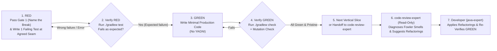

# Test-Driven Development (`test-driven-development`)

Write the failing test first at a **pre-agreed seam**. Watch it fail for the expected reason. Write only enough production code to make it pass. Repeat one vertical slice at a time, then hand off to `code-review-expert` for refactoring recommendations that the developer agent (`java-expert`) applies while keeping the suite green.

- **Core Principle**: If you didn't watch the test fail, you don't know if it tests the right thing.
- **Violating the letter of the rules is violating the spirit of the rules.**

---

## 1. The Iron Law

```text
NO PRODUCTION CODE WITHOUT A FAILING TEST FIRST
```

Write production code before the test? **Delete it completely. Start over.**
- **No exceptions**:
  - Do NOT keep it as "reference"
  - Do NOT "adapt" it while writing tests
  - Do NOT look at it
  - Delete means delete — implement fresh from failing tests.

### When to Use
- **Always**: New features, bug fixes, behavior changes, and developer-executed refactorings requested by `code-review-expert`.
- **Exceptions (must confirm with human partner)**: Throwaway prototypes, generated code, pure configuration files, or trivial pass-through glue with no independent source of truth.

---

## 2. Seams: Where Tests Go (Pre-Agreed in Spec & Design)

A **seam** *(Michael Feathers)* is the public boundary/interface where you observe behavior without reaching inside. Tests live at seams, never against private internals.

- **Test ONLY at pre-agreed seams**:
  - In our Spec-Driven workflow, candidate seams are proposed in `openspec/specs/<capability>/spec.md` and confirmed in `openspec/changes/<change>/design.md` by `java-architect` (who designs interfaces and seams, and **never** writes code).
  - If invoked standalone without a confirmed `design.md`, **stop before writing any test**, list the candidate public seams with a one-line note on what each seam catches and what it misses, and confirm with the user.
  - No test is ever written at an unconfirmed seam. The ideal number of seams for a change is one.

---

## 3. Rules of the Loop: Vertical Tracer-Bullet Slices (Red $\rightarrow$ Green) + Reviewer-Driven Refactor

Work in **vertical slices** (tracer bullets): one seam $\rightarrow$ one failing test $\rightarrow$ one minimal implementation $\rightarrow$ repeat. Never use horizontal slicing (writing a batch of tests first, then all the code).



### Step 1: RED — Write One Failing Test
Before writing the test body, pass **Gate Function 1 (Name the Break)**:
```text
BEFORE writing the test body:
  1. Name the specific production change/bug that would make this test fail
     (wrong branch, missing side effect, wrong argument, boundary case, broken contract).
     - Cannot name one           -> redesign around an observable behavior at the seam
     - "The source text changed" -> run the code and assert its behavioral effects
     - Only intentional decisions -> change detector; test the behavior that depends on the decision
  2. Confirm the expected value is derived INDEPENDENTLY of the code under test.
     - IF it reuses the production code's formula, builder, or helpers:
       Replace it with a hand-derived literal or spec-defined fixture.
```

Requirements for every test:
- **One behavior**: If the test name needs "and", split it into two vertical slices.
- **Clear capability name**: Reads like a specification (`userCanCheckoutWithValidCart`), describing **WHAT** capability exists, not **HOW** it is implemented (`checkoutCallsPaymentServiceProcess`).
- **Real code**: Exercise real domain/service objects; use mocks only at true external system boundaries.

### Step 2: Verify RED — Watch It Fail (MANDATORY — Never Skip)
Run the targeted JUnit 5 test:
```bash
./gradlew test --tests com.example.app.service.OrderServiceTest --build-cache --parallel
```
Confirm:
- The test **fails** on the assertion (once minimal compilable stub/signature exists), not due to an unrelated setup crash or typo.
- The failure message matches the missing capability.
- If the test passes immediately, you are testing existing behavior or wrote a tautological assertion — fix the test before writing production code.

### Step 3: GREEN — Write Minimal Production Code
Write the simplest Java 21 code that makes the failing test pass:
- Do NOT add extra options, unrequested configuration parameters, or speculative generality (YAGNI).
- Do NOT write code for the next test slice ahead of time.

### Step 4: Verify GREEN & Run the Mutation Check (MANDATORY)
Run both the test file and the **entire project verification suite**:
```bash
./gradlew check --build-cache --parallel
```
Confirm:
1. The new test passes.
2. **All other tests in the repository pass** ("other tests" means the full suite; any failure must be fixed or reported explicitly).
3. Compiler and test output is pristine (zero `-Xlint:all` warnings, zero errors).
4. **The Mutation Check**: Mentally mutate the production code you just wrote and confirm at least one test would fail for each realistic mutation:
   - Wrong constant or argument
   - Wrong branch handler (`if` / `switch` arm)
   - Missing state change or side effect
   - Empty, null, or default return value
   - Missing validation for zero, negative, empty, null, unauthorized, or malformed input
   *(A mutation nothing catches marks the behavior as unprotected or the test as tautological.)*

### Step 5: Refactoring via `code-review-expert` $\rightarrow$ Developer Feedback Loop & Seeding Status Back to `tasks.md`
Refactoring is **not** performed ad-hoc during the Red $\rightarrow$ Green loop:
1. Once all vertical steps for a Trackable Delivery (`D#` in `tasks.md`) are green, **`code-review-expert`** (which **never writes code**) audits the diff against the spec, agreed seams, TDD rules, and the 12-item Fowler Code Smell baseline.
2. **`code-review-expert`** outputs concrete refactoring recommendations (e.g., extracting duplicated logic, fixing Feature Envy, bundling Data Clumps into Java 21 `record` types, stripping dead/unused code).
3. Those recommendations are fed back to the developer agent (**`java-expert`**), which applies the refactoring while keeping `./gradlew check` 100% green.
4. **Seed Delivery Progress Back into `tasks.md`**: Once the delivery passes `./gradlew check` and `code-review-expert` review and is committed via `git-workflow-manager`, update `openspec/changes/<change-id>/tasks.md` on disk by checking off `[x]`, setting `Status` to `DELIVERED`, and recording the Git `Commit SHA` in the **Master Trackable Delivery Matrix**.

---

## 4. Good vs. Bad Tests & The 3 Core Anti-Patterns (Java 21 + JUnit 5 + AssertJ)

### Anti-Pattern 1: Implementation-Coupled Tests (Testing HOW instead of WHAT)
Mocks internal collaborators, tests private methods, asserts internal call counts/order, or bypasses the public interface to verify via a side channel. **The tell**: the test breaks when you refactor internal classes even though observable behavior did not change.

```java
// GOOD: Integration-style test through the agreed public seam using real domain objects
@Test
void userCanCheckoutWithValidCart() {
    Cart cart = Cart.empty().add(new LineItem("SKU-1", new Money(new BigDecimal("25.00")), 2));
    FakePaymentGateway paymentGateway = new FakePaymentGateway();
    CheckoutService service = new CheckoutService(paymentGateway);

    Receipt receipt = service.checkout(cart, PaymentMethod.card("tok_visa"));

    assertThat(receipt.status()).isEqualTo(OrderStatus.CONFIRMED);
    assertThat(receipt.totalCharged()).isEqualTo(new Money(new BigDecimal("50.00")));
}

// BAD: Coupled to internal collaborator call counts and implementation details
@Test
void checkoutCallsValidatorAndCalculator() {
    CartValidator validator = mock(CartValidator.class);
    TotalCalculator calculator = mock(TotalCalculator.class);
    // Breaks immediately if validator and calculator are merged into Cart record!
}
```

```java
// BAD: Bypasses the public interface to verify via an internal side channel
@Test
void createUserSavesRowToInternalMap() {
    userService.createUser(new CreateUserCommand("Alice"));
    assertThat(internalMapBackingStore.get("Alice")).isNotNull();
}

// GOOD: Verifies observable behavior exclusively through the public interface
@Test
void createUserMakesUserRetrievableById() {
    UserId id = userService.createUser(new CreateUserCommand("Alice"));
    Optional<UserView> retrieved = userService.findById(id);
    assertThat(retrieved).isPresent().get().extracting(UserView::name).isEqualTo("Alice");
}
```

### Anti-Pattern 2: Tautological / Mirror Assertions
The assertion recomputes the expected value using the same formula, helper, or builder as the code under test, so it passes by construction and can never catch a bug. Expected values **must** come from an independent source of truth: a hand-computed literal or a worked example from `openspec/specs/`.

```java
// BAD: Tautological — recomputes expected value the same way production code does
@Test
void calculateTotalSumsLineItems() {
    List<LineItem> items = List.of(new LineItem("A", 10), new LineItem("B", 5));
    int expected = items.stream().mapToInt(LineItem::price).sum();
    assertThat(OrderPricing.calculateTotal(items)).isEqualTo(expected);
}

// GOOD: Independent, hand-derived literal from the specification
@Test
void calculateTotalSumsLineItems() {
    List<LineItem> items = List.of(new LineItem("A", 10), new LineItem("B", 5));
    assertThat(OrderPricing.calculateTotal(items)).isEqualTo(15);
}
```

### Anti-Pattern 3: Horizontal Slicing & Change Detectors
- **Horizontal Slicing**: Writing all 10 test methods upfront before implementing anything. Bulk tests verify *imagined* structure rather than real behavior. Always work one vertical slice at a time.
- **Change Detectors**: Asserting `assertThat(RetryPolicy.MAX_RETRIES).isEqualTo(5)` instead of testing the behavior that depends on that decision ("a failing call is retried 5 times and the 6th attempt never happens").
- **Testing Framework Mechanics**: Do not test that Java records generate `equals`/`hashCode` or that a framework router invokes a callback; test **your** validation, normalization, invariants, and boundary contracts.

---

## 5. Mocking Discipline & Gate Function 2 (Exercise the Real Thing)

### When to Mock (System Boundaries Only)
Mock or fake **only** at true external system boundaries:
- External third-party APIs (payment processors, email gateways, external HTTP services)
- Databases / filesystems (when an in-memory adapter or local test stand-in is not suitable)
- Time (`java.time.Clock`) and randomness (`RandomGenerator`)

**Never mock**:
- Your own domain models (`domain/`), value objects, or internal service collaborators
- Anything you control in-process

### Designing for Testability at System Boundaries
1. **Use Constructor Dependency Injection**: Pass external boundary ports (`Clock`, `PaymentGateway`) into the constructor rather than instantiating clients internally.
2. **Prefer Specific SDK-Style Port Interfaces Over Generic Fetchers**:
   ```java
   // GOOD: Specific domain port operations — each test fake/stub returns one clear type
   public interface CustomerGateway {
       Optional<CustomerProfile> findCustomer(CustomerId id);
       List<OrderSummary> listOrders(CustomerId id);
       OrderConfirmation submitOrder(OrderRequest request);
   }

   // BAD: Generic fetcher requiring conditional URL parsing inside test doubles
   public interface HttpFetcher {
       String get(String path, Map<String, String> headers);
   }
   ```

### Gate Function 2 (Before Adding Any Mock or Test Helper)
```text
BEFORE adding a mock, fake, or test helper:
  1. List the real method's side effects; keep the ones the test depends on REAL
     — only replace the slow/external transport level below them.
  2. Ensure fake/mock responses mirror the COMPLETE real data structure (all fields),
     not a partial subset that hides downstream NullPointerExceptions.
  3. Production classes carry production methods ONLY:
     - Any reset(), clearForTest(), or destroy() method called only by tests MUST live
       in src/test/java/ utilities, never on production classes.
  4. About to assert on the mock itself?
     - The mock earns no existence assertions. Assert the observable outcome returned
       or produced by the real component under test.
```

---

## 6. Common Rationalizations & Red Flags

| Excuse | Reality |
| :--- | :--- |
| **"Too simple to test"** | Simple code breaks. A JUnit 5 test takes 30 seconds. |
| **"I'll write the tests after"** | Tests written after pass immediately — proving nothing. They are biased by the code you already wrote and never proved they can catch the regression. |
| **"Tests after achieve the same goals (spirit not ritual)"** | Tests-after answer *"what does my code currently do?"*; tests-first answer *"what MUST this seam do per the spec?"* |
| **"Already manually tested"** | Manual testing leaves no repeatable regression net when the next slice lands. |
| **"Deleting X hours of code is wasteful"** | Sunk cost fallacy. Keeping unverified code you cannot trust is the real waste. |
| **"Keep my code as reference while writing the test"** | You will adapt it, which is testing after. Delete means delete. |
| **"Need to explore/spike first"** | Fine: explore to understand the seam, then throw away the spike and start with `RED`. |
| **"The test is too hard to write"** | Listen to the test: hard to test means the module interface is too shallow or coupled. Ask `java-architect` to deepen the module interface. |
| **"TDD will slow me down"** | TDD is the fastest path to `./gradlew check` passing without debugging production regressions. |

### Red Flags — STOP, Delete Unverified Code, and Start Over
- Production code edited or created before a failing test exists
- Test written after implementation or passes on the very first run
- Cannot state what production bug would make the test fail (Gate Function 1)
- Expected value computed using production logic/helpers instead of an independent literal
- Test written at an internal class/method rather than a pre-agreed seam
- Helper/cleanup method added to a `src/main/java/` class purely for tests

---

## 7. Quick Reference & Pre-Handoff Verification Checklist

| Situation | Action |
| :--- | :--- |
| Starting a feature or bugfix | Confirm the **Pre-Agreed Test Seams** in `design.md` / `specs/` before writing any test |
| Writing a test body | Name the break it catches (a bug, not an intentional decision) |
| Building an expected value | Derive it by hand from the spec (literal/fixture); never compute it with production code |
| Bug reported | Write a failing test at the public seam reproducing the bug first, then fix |
| Wanting to refactor | Keep implementation minimal during Red $\rightarrow$ Green; let `code-review-expert` propose refactorings and apply them via `java-expert` while green |

### Mandatory Checklist Before Handoff to `code-review-expert`
- [ ] Every new behavior was built via a vertical slice at a pre-agreed seam
- [ ] Watched each test fail (`Verify RED`) for the expected reason before writing production code
- [ ] Wrote only minimal production code (`GREEN`) to pass each test
- [ ] Full suite passes (`./gradlew check --build-cache --parallel`) with zero compiler warnings
- [ ] Passed the **Mutation Check** for every new branch, constant, side effect, and boundary validation
- [ ] Zero test-only methods on `src/main/java/` classes; zero mocks of internal collaborators
