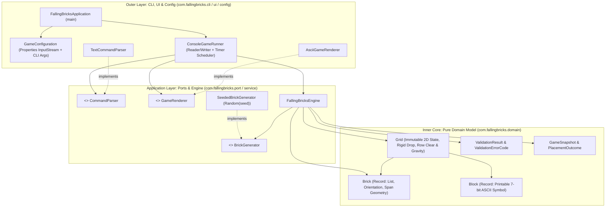

# System & Domain Design: Falling Bricks Console Game (`falling-bricks-game`)

- **OpenSpec Change**: `falling-bricks-game`
- **ADR & Decision Matrix**: `docs/adr/0001-falling-bricks-architecture-and-decision-matrix.md`
- **Capability Spec**: `openspec/changes/falling-bricks-game/specs/falling-bricks/spec.md`
- **Ubiquitous Language**: `GLOSSARY.md`

---

## 1. Architectural Overview & Clean Architecture Layers

We follow a strict **Clean / Hexagonal Architecture** (Ports & Adapters) in Java 21 where all dependencies point inward toward `com.fallingbricks.domain`.



### Package Layout (`src/main/java/com/fallingbricks/`)
1. `com.fallingbricks.domain`:
   - Zero I/O, zero logging noise, zero framework dependencies.
   - `Block` (`record Block(char symbol)`): Validates printable 7-bit ASCII (`0x21 <= symbol <= 0x7E`).
   - `Orientation` (`enum Orientation { HORIZONTAL, VERTICAL }`).
   - `Position` (`record Position(int col, int row)`).
   - `Brick` (`record Brick(List<Block> blocks, Orientation orientation)`): Enforces 3 non-null blocks (`REQUIRED_BLOCKS = 3`), defensive copy via `List.copyOf(blocks)`, `toggleOrientation()`, `cycleBlocks()`, `widthSpan()`, `heightSpan()`, and `occupiedPositions(int anchorCol, int anchorRow)`.
   - `Grid`: Immutable 2D board (`width`, `height`, private `Block[][] cells`). All mutations (`lockRigidBrick`, `dropRigidBrick`, `clearHorizontalMatchesAndApplyGravity`) return a new `Grid` or `PlacementOutcome` with defensive array copies.
   - `Command` (`enum Command { LEFT, RIGHT, ORIENT, CYCLE, DROP, TICK, RETRY, NEW_GAME, QUIT }`).
   - `GameStatus` (`enum GameStatus { ACTIVE, COMPLETED, GAME_OVER, QUIT }`).
   - `ValidationErrorCode` & `ValidationResult<T>` (`sealed interface ValidationResult<T> permits Valid, Invalid`).
   - `PlacementOutcome` (`record PlacementOutcome(Grid grid, int rowsOrMatchesCleared, int blocksCleared, int chainCount, int pointsEarned)`).
   - `GameSnapshot` (`record GameSnapshot(Grid grid, Optional<Brick> activeBrick, int activeCol, int activeRow, Optional<Brick> nextBrick, int remainingBricks, long seed, int score, int totalClears, GameStatus status, Optional<PlacementOutcome> lastOutcome)`).
2. `com.fallingbricks.config`:
   - `GameConfiguration`: Immutable `record` holding `width`, `height`, `maxWidth` (default `20`), `maxHeight` (default `20`), `brickCount` (default `15`), `seed`, `tickIntervalMs` (default `1000`), `symbols` (default `"@#$%&"`), and `maxBrickSpan` (`3`).
   - Loads from `InputStream` (`Properties`) and CLI arguments (`String[] args`) with **zero hardcoded file paths**.
   - Validates all invariants (`minWidth/Height >= maxBrickSpan`, `width/height <= maxWidth/Height`, `brickCount >= (height / maxBrickSpan) + 1` so the queue can always overflow the grid, valid ASCII symbol set).
3. `com.fallingbricks.port`:
   - `BrickGenerator`: Produces deterministic `SpawnedBrick(Brick brick, int spawnCol)` items, exposes `remainingCount()`, `peekNext()`, `seed()`, `resetWithSameSeed()`, and `resetWithNewSeed(long newSeed)`.
   - `CommandParser`: `ValidationResult<Command> parse(String rawInput)`.
   - `GameRenderer`: Renders startup banner, `GameSnapshot`, `ValidationResult.Invalid<?>`, and end-of-level retry prompt to an injected `Writer`.
4. `com.fallingbricks.service`:
   - `SeededBrickGenerator`: Implements `BrickGenerator` using `new java.util.Random(seed)`.
   - `FallingBricksEngine`: Deep module coordinating active brick state (`activeBrick`, `activeCol`, `activeRow`), command execution (`LEFT`, `RIGHT`, `ORIENT`, `CYCLE`, `DROP`, `TICK`, `RETRY`, `NEW_GAME`, `QUIT`), collision & bounds validation, vertical overflow detection, score calculation, and SLF4J logging.
5. `com.fallingbricks.ui` & `com.fallingbricks.cli`:
   - `TextCommandParser`: Parses single-letter and full-word commands (`L`/`LEFT`, `R`/`RIGHT`, `O`/`ORIENT`, `C`/`CYCLE`, `D`/`DROP`, `T`/`TICK`, `RETRY`, `N`/`NEW`, `Q`/`QUIT`).
   - `AsciiGameRenderer`: Formats the bordered ASCII console grid (matching the approved mockups in `proposal.md`) to a `PrintWriter`/`Writer`.
   - `ConsoleGameRunner`: Drives the loop over `BufferedReader` and `PrintWriter` (with optional scheduled timer thread when `tickIntervalMs > 0` in interactive mode).
   - `FallingBricksApplication`: Entrypoint (`main(String[] args)`).

---

## 2. Detailed Physics & Domain Algorithms (`Q1`–`Q5`)

### 2.1 Coordinate System & Spawn Position (`Q2` & `Q5`)
- Columns: `0 <= col < width` (left to right).
- Rows: `0 <= row < height` where **`row = 0` is the bottom floor** and **`row = height - 1` is the top row**.
- When a `Brick` spawns at the top of the grid from `SeededBrickGenerator(seed)`:
  - Valid horizontal anchor columns are `0 <= spawnCol <= width - brick.widthSpan()`, chosen via `random.nextInt(width - brick.widthSpan() + 1)`.
  - For `Orientation.HORIZONTAL` (`widthSpan = 3, heightSpan = 1`): `anchorRow = height - 1` (occupies `(spawnCol, height-1)`, `(spawnCol+1, height-1)`, `(spawnCol+2, height-1)`).
  - For `Orientation.VERTICAL` (`widthSpan = 1, heightSpan = 3`): `anchorRow = height - 3` (occupies `(spawnCol, height-3)` [bottom block], `(spawnCol, height-2)` [middle block], `(spawnCol, height-1)` [top block]).
  - **Immediate Spawn Overflow Check (`Q5`)**: If any of the newly spawned brick's occupied positions on the grid is already occupied by a stacked block, the brick cannot enter the board $\rightarrow$ `ValidationErrorCode.VERTICAL_OVERFLOW` and `GameStatus.GAME_OVER`.

### 2.2 Rigid-Bar Airborne Movement & Drop Physics (`Q3`)
While airborne, a brick moves and drops as a **single rigid 3-block bar**:
- **Occupied Positions Helper**:
  ```java
  public List<Position> occupiedPositions(int anchorCol, int anchorRow) {
      return switch (orientation) {
          case HORIZONTAL -> List.of(
              new Position(anchorCol, anchorRow),
              new Position(anchorCol + 1, anchorRow),
              new Position(anchorCol + 2, anchorRow)
          );
          case VERTICAL -> List.of(
              new Position(anchorCol, anchorRow),
              new Position(anchorCol, anchorRow + 1),
              new Position(anchorCol, anchorRow + 2)
          );
      };
  }
  ```
- **Placement Validity Check (`Grid.canOccupy(Brick brick, int anchorCol, int anchorRow)`)**:
  Returns `true` iff for every `pos` in `brick.occupiedPositions(anchorCol, anchorRow)`:
  - `0 <= pos.col() < width`
  - `0 <= pos.row() < height`
  - `cellAt(pos.col(), pos.row()).isEmpty()`
- **Timer Step (`Command.TICK`)**:
  - Checks `grid.canOccupy(activeBrick, activeCol, activeRow - 1)`.
  - If `true`: `activeRow = activeRow - 1` (brick moves down 1 row as a rigid bar).
  - If `false`: the rigid bar has contacted either the floor (`row == 0`) or at least one stacked block at `row - 1` $\rightarrow$ the brick immediately locks at `(activeCol, activeRow)`.
- **Instant Drop (`Command.DROP`)**:
  - Decrements `targetRow` from `activeRow` down toward `0` while `grid.canOccupy(activeBrick, activeCol, targetRow - 1)` is `true`.
  - Locks all 3 blocks into the `Grid` at `brick.occupiedPositions(activeCol, targetRow)` as independent `Block` cells.

### 2.3 Horizontal Row Clearing / Matching & Individual-Block Gravity (`Q4`)
Once a brick locks into `Grid`, **its original 3-block rigid shape is discarded**; the grid stores only individual `Block` cells at `(col, row)`.
Resolution proceeds in a deterministic loop (`chainStep = 1, 2, ...`):
1. **Detect Horizontal Clears**:
   - **Full Horizontal Row**: Any row `r` (`0 <= r < height`) where all `width` cells `(0..width-1, r)` are non-empty marks all cells `(0..width-1, r)` for clearing.
   - **Horizontal Contiguous Symbol Match**: In any row `r`, any contiguous horizontal run of `>= 3` identical symbols (`cells[r][c].symbol == cells[r][c+1].symbol == cells[r][c+2].symbol ...`) marks those contiguous cells for clearing.
2. **Terminate or Clear**:
   - If the set of marked `(col, row)` positions is empty, the cascade terminates.
   - Otherwise, remove all marked blocks from the grid and increment `rowsOrMatchesCleared`, `blocksCleared`, and `score` (`100 * clearedCellsInStep * chainStep`).
3. **Individual-Block Column Gravity**:
   - For each column `c` (`0 <= c < width`) independently:
     - Collect all remaining non-empty `Block`s in column `c` from bottom to top (`row = 0 .. height - 1`).
     - Write them back into column `c` starting at `writeRow = 0, 1, ...` and fill remaining top rows with `null` (empty).
   - Because each column compacts independently, any horizontal bridge formed by a previously locked rigid horizontal brick splits naturally into individual falling blocks whenever support beneath part of the bridge is cleared!
4. **Repeat Step 1** (`chainStep++`) until no further horizontal rows/matches clear.

---

## 3. Logging Design (`SLF4J + Logback`)

### Dependencies (`gradle/libs.versions.toml`)
- `org.slf4j:slf4j-api:2.0.16`
- `ch.qos.logback:logback-classic:1.5.12`

### Logback Configuration (`src/main/resources/logback.xml`)
- **`FILE` Appender**: Writes timestamped structured logs (`%d{ISO8601} [%thread] %-5level %logger{36} - %msg%n`) to `${fallingbricks.log.dir:-logs}/falling-bricks.log` at `DEBUG` level.
- **`STDERR_WARN` Appender**: Writes only `WARN` and `ERROR` events to `System.err` (with threshold filter `WARN`), ensuring `System.out` (`STDOUT`) is 100% dedicated to `AsciiGameRenderer`.

---

## 4. Future Expansion Points (Design Considerations Without Overbuilding)

### 4.1 Future Expansion Point 1: Level Winnability Validation (`SeedWinnabilityValidator`)
- **Current v1 Scope**: Per user decision, v1 does **not** validate whether a seeded brick queue is guaranteed winnable; it validates only that the queue has valid ASCII bricks and enough bricks (`brickCount >= (height / 3) + 1`) to potentially cause an overflow.
- **Architectural Seam for Future Expansion**: `SeededBrickGenerator` implements the `BrickGenerator` interface. In a future iteration, a decorator or strategy `WinnableSeedBrickGenerator` / `SeedWinnabilityValidator` can wrap `SeededBrickGenerator` to run bounded lookahead search on a candidate `seed` before starting a level, without changing a single line of `FallingBricksEngine` or `Grid`.

### 4.2 Future Expansion Point 2: Variable Brick Shapes & Sizes
- **Current v1 Scope**: Per user decision, v1 strictly implements 3-block `HORIZONTAL` ($1 \times 3$) and `VERTICAL` ($3 \times 1$) rigid bars (**do not build extra shapes or sizes in v1**).
- **Architectural Seam for Future Expansion**:
  - Instead of hardcoding `col + 2 < width` or `row - 2 >= 0` inside `Grid` and `FallingBricksEngine`, `Brick` encapsulates its own geometry via:
    - `int widthSpan()`
    - `int heightSpan()`
    - `List<Position> occupiedPositions(int anchorCol, int anchorRow)`
  - `Grid.canOccupy(Brick, int, int)` and `Grid.lockBrick(Brick, int, int)` iterate over `brick.occupiedPositions(anchorCol, anchorRow)`.
  - `GameConfiguration` validates `minWidth >= config.maxBrickSpan()` and `minHeight >= config.maxBrickSpan()`.
  - If L-shapes, $2 \times 2$ squares, or 4-block pieces are added in a future release, `Grid` and `FallingBricksEngine` collision/drop loops require zero structural changes.
