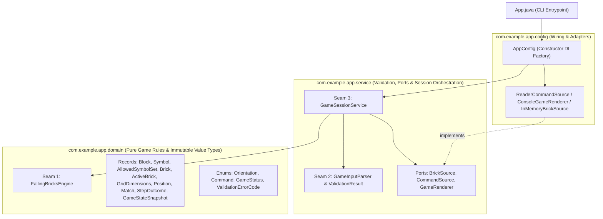

# System & Deep-Module Design (`falling-bricks-game`)

- **Change ID**: `falling-bricks-game`
- **Design Personas**: `system-design` & `java-architect` (Strictly No-Code Phase)
- **Glossary**: [GLOSSARY.md](../../../GLOSSARY.md)
- **Decision Matrix**: [ADR-0001](../../../docs/adr/0001-falling-bricks-architecture-and-decision-matrix.md)
- **Capability Spec**: [specs/falling-bricks/spec.md](specs/falling-bricks/spec.md)

---

## 1. Context & Architectural Goals

### 1.1 Context
`java-test` is structured into three clean Java 21 packages (`com.example.app.domain`, `com.example.app.service`, `com.example.app.config`). We are designing a console-based **Falling Bricks** puzzle engine and session runner that satisfies strict reviewer feedback:
- **Validate everything** (empty inputs, invalid symbols/orientations, undersized/oversized grids, dodgy commands, out-of-bounds moves).
- **Clean, immutable domain model** (Java 21 `record` value objects, zero mutable public fields, `List.copyOf` defensive copies, zero hardcoded file paths).
- **Test actual state, not console output**, plus **real-component integration tests** running the real parser, engine, and service together.

### 1.2 Goals & Non-Goals
- **Goals**:
  1. High-leverage, deep `FallingBricksEngine` module hiding drop physics, simultaneous orthogonal match detection, and column gravity cascades behind a 2-method public interface (`execute(Command)` and `snapshot()`).
  2. Total input validation at the `GameInputParser` seam using a sealed `ValidationResult<T>` hierarchy.
  3. Clean Hexagonal / Ports-and-Adapters separation (`BrickSource`, `CommandSource`, `GameRenderer` interfaces in `service`; constructor wiring in `config/AppConfig.java`).
- **Non-Goals**:
  1. No asynchronous background timers or non-standard native terminal bindings.
  2. No speculative single-adapter interfaces inside `domain/`.

---

## 2. "Design It Twice" — Parallel Interface Evaluation (`system-design`)

We compared four candidate interface designs for the core `FallingBricksEngine` module:

| Design Option | Public Signature Shape | Interface Depth & Locality | Testability at Seam (State vs. Mocks) | Verdict |
| :--- | :--- | :--- | :--- | :--- |
| **Design A — Command-Driven State Machine + Immutable Snapshot** | `GameStateSnapshot execute(Command)` + `GameStateSnapshot snapshot()` | **Deep**: Callers learn 2 methods and 1 immutable `GameStateSnapshot` record; drop physics, simultaneous match scanning, and multi-wave gravity cascades are 100% localized inside `domain`. | **Optimal**: Every test asserts directly on the returned `GameStateSnapshot` (`cellAt`, `score`, `matchesCleared`, `status`, `stepOutcome`) with zero mocks. | **SELECTED** |
| **Design B — Fine-Grained Step Orchestrator Exposed to Caller** | Caller invokes `moveLeft()`, `dropWithoutClearing()`, `findMatches()`, `clearMatches()`, `applyGravity()` | **Shallow**: Leaks temporal ordering invariants (`drop -> match -> clear -> gravity -> repeat`) into `service/`, violating **Locality** (Shotgun Surgery risk). | Poor: Callers can forget a cascade loop step. | **Rejected** |
| **Design C — Callback/Listener Observer Engine** | `void execute(Command, GameEventListener listener)` | Medium depth, but forces tests to set up mock/spy listeners to inspect board state after a command. | Violates the no-mock state-testing preference. | **Rejected** |
| **Design D — Pure Static Function (`Transition.apply(State, Command)`)** | Stateless function taking and returning full `GameStateSnapshot` | High purity, but forces callers to thread state references manually on every command in interactive sessions. | Good, and we keep its best property inside Design A by making `GameStateSnapshot` 100% immutable! | **Hybridized into Design A** |

---

## 3. Deep Module & Clean Package Architecture (`java-architect`)



### 3.1 `com.example.app.domain` (100% Framework- & I/O-Free)
All value types are `public record` or `public enum` with zero mutable fields and strict compact-constructor validation:
- `AllowedSymbolSet(Set<Character> symbols)`: Defensively copies via `Set.copyOf(symbols)`; provides `AllowedSymbolSet.defaultSet()` and validates printable non-whitespace characters.
- `Block(char symbol)`: Validates ` !Character.isWhitespace(symbol) && !Character.isISOControl(symbol)`.
- `Orientation`: `HORIZONTAL` (`columnSpan = 3`, `rowSpan = 1`), `VERTICAL` (`columnSpan = 1`, `rowSpan = 3`).
- `Brick(List<Block> blocks, Orientation orientation)`: Compact constructor enforces `Objects.requireNonNull`, `blocks = List.copyOf(blocks)`, and `blocks.size() == 3`.
- `ActiveBrick(Brick brick, int column)`: Represents the currently controlled brick above the grid; supports immutable transitions `moveLeft()`, `moveRight(GridDimensions)`, `toggleOrientation(GridDimensions)`, and `cycleSymbols()`.
- `GridDimensions(int width, int height)`: Compact constructor enforces `3 <= width <= 20` and `3 <= height <= 30`.
- `Position(int row, int column)`: Coordinate record (`row >= 0`, `column >= 0`).
- `Command`: `MOVE_LEFT`, `MOVE_RIGHT`, `ORIENT`, `CYCLE`, `DROP`, `QUIT`.
- `GameStatus`: `IN_PROGRESS`, `COMPLETED`, `GAME_OVER`, `QUIT`.
- `ValidationErrorCode`:
  - `EMPTY_INPUT`
  - `GRID_DIMENSIONS_OUT_OF_BOUNDS`
  - `INVALID_BRICK_LENGTH`
  - `INVALID_SYMBOL`
  - `INVALID_ORIENTATION`
  - `INVALID_COMMAND`
  - `OUT_OF_BOUNDS_MOVE`
  - `GAME_ALREADY_FINISHED`
- `StepOutcome(boolean applied, Optional<ValidationErrorCode> errorCode, String message)`: Factory methods `StepOutcome.applied(String message)` and `StepOutcome.rejected(ValidationErrorCode code, String message)`.
- `GameStateSnapshot`:
  ```java
  public record GameStateSnapshot(
      GridDimensions dimensions,
      List<List<Optional<Block>>> cells,
      Optional<ActiveBrick> activeBrick,
      int remainingBricks,
      int matchesCleared,
      int blocksCleared,
      int lastCascadeWaves,
      long score,
      GameStatus status,
      StepOutcome lastOutcome
  )
  ```
  - Compact constructor performs a deep defensive copy (`cells.stream().map(List::copyOf).toList()`) and provides `Optional<Block> cellAt(int row, int col)`.
- `FallingBricksEngine`:
  - Constructed with `(GridDimensions dimensions, List<Brick> brickQueue)` (defensively copying `brickQueue`).
  - Public Seam Methods:
    - `GameStateSnapshot snapshot()`
    - `GameStateSnapshot execute(Command command)`

### 3.2 `com.example.app.service` (Validation Seam, Ports & Session Orchestration)
- `ValidationResult<T>` (`sealed interface ValidationResult<T> permits ValidationResult.Valid, ValidationResult.Invalid`):
  - `record Valid<T>(T value) implements ValidationResult<T>`
  - `record Invalid<T>(ValidationErrorCode errorCode, String message) implements ValidationResult<T>`
- `GameInputParser`:
  - `ValidationResult<GridDimensions> parseDimensions(String raw)` (e.g. `"6x8"` or `"6 8"`)
  - `ValidationResult<Brick> parseBrick(String raw, AllowedSymbolSet allowedSymbols)` (e.g. `"@#* H"` or `"$$% V"`)
  - `ValidationResult<List<Brick>> parseBrickLines(List<String> lines, AllowedSymbolSet allowedSymbols)`
  - `ValidationResult<List<Command>> parseCommandLine(String rawLine)` (supports single commands `"L"`, `"LEFT"`, `"D"` or space-separated sequences `"R R O D"`)
- Port Interfaces (Each has 2+ real adapters — console/Reader for CLI and in-memory/scripted for integration tests):
  - `BrickSource`: `ValidationResult<List<Brick>> loadBricks()`
  - `CommandSource`: `Optional<String> nextCommandLine()`
  - `GameRenderer`: `void render(GameStateSnapshot snapshot)` and `void renderError(ValidationErrorCode code, String message)`
- `GameSessionService`:
  - Constructor-injected with `(GridDimensions dimensions, BrickSource brickSource, CommandSource commandSource, GameInputParser parser, GameRenderer renderer)`.
  - `ValidationResult<GameStateSnapshot> runSession()`: Loads and validates bricks, initializes `FallingBricksEngine`, reads command lines from `CommandSource` until `status != IN_PROGRESS` or input is exhausted, renders each state transition to `GameRenderer`, and returns the final `GameStateSnapshot`.

### 3.3 `com.example.app.config` (Constructor DI Wiring & Stream Adapters)
- `AppConfig`: Pure Java constructor-based DI factory wiring `GameInputParser`, `BrickSource`, `CommandSource` (`BufferedReader` over `InputStream` / `Reader` — zero hardcoded file paths), `ConsoleGameRenderer` (`PrintWriter` over `OutputStream` / `Writer`), and `GameSessionService`.

---

## 4. Confirmed Pre-Agreed Test Seams (`design.md` Gate)

| Seam # | Target Seam Class | Package | Dependency Category | Adapter / Test Strategy | What It Catches |
| :--- | :--- | :--- | :--- | :--- | :--- |
| **Seam 1** | `FallingBricksEngine` & Domain Value Records | `com.example.app.domain` | **In-Process** | Direct JUnit 5 + AssertJ state assertions on `GameStateSnapshot` and domain records (Zero mocks) | Value-type immutability, defensive copying, spawn centering, `L`/`R`/`O`/`C` movement & boundary rejection, `H`/`V` drop physics, simultaneous orthogonal 3+ match clearing, multi-wave gravity cascades, `COMPLETED` & `GAME_OVER` transitions. |
| **Seam 2** | `GameInputParser` | `com.example.app.service` | **In-Process** | Direct JUnit 5 + AssertJ assertions on `ValidationResult.Valid` and `ValidationResult.Invalid` (Zero mocks) | Empty/null/blank inputs, undersized/oversized grids, invalid symbols, invalid orientations, wrong block counts ($\ne 3$), and dodgy commands. |
| **Seam 3** | `GameSessionService` + `AppConfig` | `com.example.app.service` & `config` | **Local-Substitutable** | Real `GameInputParser` + real `FallingBricksEngine` + real `GameSessionService` wired via `AppConfig` with `StringReader` / in-memory `BrickSource` | End-to-end multi-brick gameplay, recovery from invalid command lines mid-game without losing board state, and clean CLI exit codes. |

---

## 5. Complete Decision Matrix Reference

See [ADR-0001](../../../docs/adr/0001-falling-bricks-architecture-and-decision-matrix.md) and [proposal.md](proposal.md#5-decision-matrix-decisions-taken--open-confirmation-items) for the full 9-item Decision Matrix (`DEC-01` through `DEC-09`).
