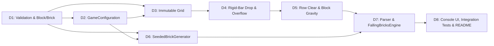

# Trackable TDD Delivery Plan: Falling Bricks Console Game (`falling-bricks-game`)

- **OpenSpec Change**: `falling-bricks-game`
- **Plan Status**: **HOLDING FOR USER REVIEW** (0 / 8 Deliveries Executed — Awaiting Approval)
- **Methodology**: Vertical-Slice Red-Green-Refactor TDD (`test-driven-development` + `java-expert` + `code-review-expert` + `git-workflow-manager`)
- **Verification Gate per Delivery**: `./gradlew test check` + `code-review-expert` 2-Axis Audit + Conventional Commit (`[changes/falling-bricks-game:D#]`)

---

## 1. Master Trackable Delivery Matrix (`D1` – `D8`)

Each delivery is a self-contained, independently verifiable, committable increment. As each delivery completes, its task checkboxes (`[x]`), test count, `code-review-expert` verdict, status (`DELIVERED`), and Git commit SHA MUST be updated in this table on disk.

| Delivery ID | Deliverable Name | Spec Reqs & ADR Decisions | Production Artifacts | Test Artifacts (State-Based) | Verification & Review Gate | Target Commit Message | Status | Commit SHA |
| :--- | :--- | :--- | :--- | :--- | :--- | :--- | :--- | :--- |
| **D1** | **Logging Setup, Validation Types & Immutable ASCII `Block` / `Brick`** | Req 2 (`2.1–2.4`), `DEC-02`, `DEC-03`, `DEC-10`, `DEC-13` | `logback.xml`, `ValidationErrorCode`, `ValidationResult`, `Block`, `Orientation`, `Position`, `Brick` | `BlockTest`, `BrickTest` | `./gradlew test` + `code-review-expert` sign-off | `feat(domain): deliver D1 validation types and immutable ASCII Block/Brick [changes/falling-bricks-game:D1]` | `PENDING` | `—` |
| **D2** | **Configurable Parameters (`GameConfiguration`) & Overflow-Capable Queue Bounds** | Req 1 (`1.1–1.4`), Req 3 (`3.2`), `DEC-04`, `DEC-05`, `DEC-09`, `DEC-11` | `application.properties`, `GameConfiguration` | `GameConfigurationTest` | `./gradlew test` + `code-review-expert` sign-off | `feat(config): deliver D2 GameConfiguration properties and CLI validation [changes/falling-bricks-game:D2]` | `PENDING` | `—` |
| **D3** | **Immutable `Grid` Value Object & Defensive State Snapshots** | Req 1 (`1.1–1.5`), `DEC-01`, `DEC-09` | `Grid` (creation, bounds, defensive copy, `canOccupy`) | `GridTest` (Bounds & Immutability) | `./gradlew test` + `code-review-expert` sign-off | `feat(domain): deliver D3 immutable Grid with defensive snapshots [changes/falling-bricks-game:D3]` | `PENDING` | `—` |
| **D4** | **Rigid-Bar Airborne Drop Physics & Vertical Overflow Detection** | Req 4 (`4.2`), Req 6 (`6.1`), `DEC-07`, `DEC-09` | `Grid` (`computeRigidDropRow`, `lockRigidBrick`) | `GridTest` (Rigid-bar drop & `VERTICAL_OVERFLOW`) | `./gradlew test` + `code-review-expert` sign-off | `feat(domain): deliver D4 rigid-bar drop physics and vertical overflow check [changes/falling-bricks-game:D4]` | `PENDING` | `—` |
| **D5** | **Horizontal Row Clearing / Matching & Individual-Block Gravity Cascade** | Req 5 (`5.1–5.2`), `DEC-08` | `PlacementOutcome`, `Grid` (`clearMatchesAndApplyGravity`) | `GridTest` (Full row clear, symbol match, individual gravity cascade) | `./gradlew test` + `code-review-expert` sign-off | `feat(domain): deliver D5 horizontal row clearing and individual block gravity [changes/falling-bricks-game:D5]` | `PENDING` | `—` |
| **D6** | **Deterministic `SeededBrickGenerator` (`Random(seed)`) & Same-Seed Reset** | Req 3 (`3.1–3.3`), `DEC-05`, `DEC-06`, `DEC-12` | `BrickGenerator`, `SpawnedBrick`, `SeededBrickGenerator` | `SeededBrickGeneratorTest` | `./gradlew test` + `code-review-expert` sign-off | `feat(service): deliver D6 deterministic SeededBrickGenerator and retry reset [changes/falling-bricks-game:D6]` | `PENDING` | `—` |
| **D7** | **`TextCommandParser` & `FallingBricksEngine` (`TICK`, `DROP`, `RETRY`, Logging)** | Req 3 (`3.3`), Req 4 (`4.1–4.3`), Req 6 (`6.1–6.2`), `DEC-06`, `DEC-10` | `Command`, `GameStatus`, `GameSnapshot`, `CommandParser`, `TextCommandParser`, `FallingBricksEngine` | `TextCommandParserTest`, `FallingBricksEngineTest` | `./gradlew test` + `code-review-expert` sign-off | `feat(service): deliver D7 TextCommandParser and FallingBricksEngine state machine [changes/falling-bricks-game:D7]` | `PENDING` | `—` |
| **D8** | **Console UI, Real Multi-Component Integration Suite & Maintainer `README.md`** | All Reqs (`1–6`), All `DEC-01..13` | `GameRenderer`, `AsciiGameRenderer`, `ConsoleGameRunner`, `FallingBricksApplication`, `README.md` | `AsciiGameRendererTest`, `FallingBricksIntegrationTest` (Zero Mocks) | `./gradlew test check` + Final 2-Axis Code Review + Clean Repo Audit | `feat(ui): deliver D8 console runner, real integration tests and README [changes/falling-bricks-game:D8]` | `PENDING` | `—` |

---

## 2. Dependency Flow Across Deliveries

---

## 3. Detailed Delivery Breakdown & Acceptance Checklists

### Delivery D1: Logging Setup (`SLF4J + Logback`), `ValidationResult` & Printable 7-Bit ASCII `Block` / `Brick`
- **Status**: `PENDING`
- **Spec & ADR Traceability**: Requirement 2 (`Scenarios 2.1–2.4`), `DEC-02`, `DEC-03`, `DEC-10`, `DEC-13`
- **Deliverable Files**:
  - `gradle/libs.versions.toml` & `build.gradle` (add `slf4j-api` & `logback-classic`; remove starter placeholder `App.java` / `AppTest.java` when replaced)
  - `src/main/resources/logback.xml`
  - `src/main/java/com/fallingbricks/domain/ValidationErrorCode.java`
  - `src/main/java/com/fallingbricks/domain/ValidationResult.java`
  - `src/main/java/com/fallingbricks/domain/Block.java`
  - `src/main/java/com/fallingbricks/domain/Orientation.java`
  - `src/main/java/com/fallingbricks/domain/Position.java`
  - `src/main/java/com/fallingbricks/domain/Brick.java`
  - `src/test/java/com/fallingbricks/domain/BlockTest.java`
  - `src/test/java/com/fallingbricks/domain/BrickTest.java`
- **Task Checklist**:
  - [ ] **D1.1 (Build & Logging Config)**: Configure `slf4j-api` and `logback-classic` in `gradle/libs.versions.toml` and `build.gradle`; create `src/main/resources/logback.xml` routing `DEBUG+` to `logs/falling-bricks.log` and `WARN+` to `STDERR` (keeping `STDOUT` untouched for console UI).
  - [ ] **D1.2 (RED $\rightarrow$ GREEN `Block`)**: Write failing tests in `BlockTest` verifying `Block.create(char)` accepts printable non-whitespace 7-bit ASCII (`0x21..0x7E`) and rejects whitespace (`' '`, `'\t'`, `'\n'`), control chars (`'\0'`, `0x7F`), and non-ASCII chars (`'★'`, `'é'`) with `ValidationErrorCode.INVALID_SYMBOL`. Implement `Block`.
  - [ ] **D1.3 (RED $\rightarrow$ GREEN `Brick` Validation & Defensive Copy)**: Write failing tests in `BrickTest` verifying `Brick.create(blocks, orientation)` rejects `null` orientation (`INVALID_ORIENTATION`), wrong block counts (`INVALID_BRICK_SIZE`), and defensively copies `List<Block>` via `List.copyOf` (mutating the input `ArrayList` or calling `brick.blocks().add(...)` cannot alter `Brick`). Implement `Brick`.
  - [ ] **D1.4 (RED $\rightarrow$ GREEN `Brick` Transformations & Span Geometry)**: Write failing tests in `BrickTest` for `toggleOrientation()`, `cycleBlocks()` (`[A,B,C] -> [C,A,B]`), `widthSpan()`, `heightSpan()`, and `occupiedPositions(anchorCol, anchorRow)`. Implement on `Brick`.
  - [ ] **D1.5 (REFACTOR & Delivery Gate)**: Run `./gradlew test`, run `code-review-expert` review on D1, commit D1, and record commit SHA in Master Delivery Matrix.

---

### Delivery D2: `GameConfiguration` (`application.properties` + CLI Overrides + Overflow-Capable Brick Count Validation)
- **Status**: `PENDING`
- **Spec & ADR Traceability**: Requirement 1 (`Scenarios 1.1–1.4`), Requirement 3 (`Scenario 3.2`), `DEC-04`, `DEC-05`, `DEC-09`, `DEC-11`
- **Deliverable Files**:
  - `src/main/resources/application.properties`
  - `src/main/java/com/fallingbricks/config/GameConfiguration.java`
  - `src/test/java/com/fallingbricks/config/GameConfigurationTest.java`
- **Task Checklist**:
  - [ ] **D2.1 (RED $\rightarrow$ GREEN Defaults & Stream/CLI Loading)**: Write failing tests in `GameConfigurationTest` for default config (`width=6`, `height=12`, `maxWidth=20`, `maxHeight=20`, `brickCount=15`, `tickIntervalMs=1000`, `symbols="@#$%&"`, `maxBrickSpan=3`), `InputStream` (`Properties`) overrides, and CLI flag overrides (`--width`, `--height`, `--max-width`, `--max-height`, `--bricks`, `--seed`, `--tick-ms`, `--symbols`) with zero hardcoded file paths.
  - [ ] **D2.2 (RED $\rightarrow$ GREEN Grid Bound Validation)**: Write failing tests in `GameConfigurationTest` verifying negative/zero dimensions or `< maxBrickSpan (3)` fail with `GRID_TOO_SMALL`, and dimensions exceeding `maxWidth`/`maxHeight` (default `20x20`, or custom configured max) fail with `GRID_TOO_LARGE`.
  - [ ] **D2.3 (RED $\rightarrow$ GREEN Overflow-Capable `brickCount` Validation)**: Write failing tests in `GameConfigurationTest` verifying `brickCount * maxBrickSpan > height` (e.g., on `height=12`, `brickCount=4` fails with `INSUFFICIENT_BRICK_COUNT`, while `brickCount=5` succeeds).
  - [ ] **D2.4 (REFACTOR & Delivery Gate)**: Add `src/main/resources/application.properties`, run `./gradlew test`, run `code-review-expert` review on D2, commit D2, and record commit SHA in Master Delivery Matrix.

---

### Delivery D3: Immutable `Grid` Value Object & Defensive State Snapshots
- **Status**: `PENDING`
- **Spec & ADR Traceability**: Requirement 1 (`Scenarios 1.1–1.5`), `DEC-01`, `DEC-09`
- **Deliverable Files**:
  - `src/main/java/com/fallingbricks/domain/Grid.java`
  - `src/test/java/com/fallingbricks/domain/GridTest.java`
- **Task Checklist**:
  - [ ] **D3.1 (RED $\rightarrow$ GREEN Grid Creation & Bounds)**: Write failing tests in `GridTest` for `Grid.create(width, height, maxWidth, maxHeight)` validating `min >= 3` (`GRID_TOO_SMALL`), `max <= maxWidth/maxHeight` (`GRID_TOO_LARGE`), and empty cell initialization (`row = 0` bottom floor to `row = height - 1` top row).
  - [ ] **D3.2 (RED $\rightarrow$ GREEN Defensive Copying)**: Write failing tests in `GridTest` proving that mutating the array returned by `grid.cellsSnapshot()` never modifies the `Grid` instance.
  - [ ] **D3.3 (RED $\rightarrow$ GREEN Placement Bounds & Collision Query)**: Write failing tests in `GridTest` for `grid.canOccupy(brick, anchorCol, anchorRow)` across horizontal/vertical orientations, grid boundaries, and occupied cells.
  - [ ] **D3.4 (REFACTOR & Delivery Gate)**: Run `./gradlew test`, run `code-review-expert` review on D3, commit D3, and record commit SHA in Master Delivery Matrix.

---

### Delivery D4: Rigid-Bar Drop Physics (`Q3`) & Vertical Overflow Detection (`Q5`)
- **Status**: `PENDING`
- **Spec & ADR Traceability**: Requirement 4 (`Scenario 4.2`), Requirement 6 (`Scenario 6.1`), `DEC-07`, `DEC-09`
- **Deliverable Files**:
  - `src/main/java/com/fallingbricks/domain/Grid.java` (rigid-bar drop and lock methods)
  - `src/test/java/com/fallingbricks/domain/GridTest.java` (drop & overflow test cases)
- **Task Checklist**:
  - [ ] **D4.1 (RED $\rightarrow$ GREEN Vertical Rigid Drop)**: Write failing tests in `GridTest` for dropping a `VERTICAL` ($3 \times 1$) brick onto the floor (`rows 0..2`) and onto an existing stack (`rows stackTop+1 .. stackTop+3`).
  - [ ] **D4.2 (RED $\rightarrow$ GREEN Horizontal Rigid-Bar Drop Over Uneven Stack)**: Write failing tests in `GridTest` verifying that a `HORIZONTAL` ($1 \times 3$) brick dropped over columns where `col 1` has height 3 (`row=2`) and `cols 2..3` are empty stops as a **rigid horizontal bar** at `row = 3` across `cols 1, 2, 3`.
  - [ ] **D4.3 (RED $\rightarrow$ GREEN Vertical Overflow Error)**: Write failing tests in `GridTest` verifying that locking or spawning a brick when any of its 3 blocks overlaps an occupied cell or exceeds `height - 1` returns `ValidationResult.Invalid(ValidationErrorCode.VERTICAL_OVERFLOW)`.
  - [ ] **D4.4 (REFACTOR & Delivery Gate)**: Run `./gradlew test`, run `code-review-expert` review on D4, commit D4, and record commit SHA in Master Delivery Matrix.

---

### Delivery D5: Horizontal Row Clearing / Matching & Individual-Block Gravity Cascade (`Q4`)
- **Status**: `PENDING`
- **Spec & ADR Traceability**: Requirement 5 (`Scenarios 5.1–5.2`), `DEC-08`
- **Deliverable Files**:
  - `src/main/java/com/fallingbricks/domain/PlacementOutcome.java`
  - `src/main/java/com/fallingbricks/domain/Grid.java` (horizontal row/match clear + individual-block column gravity cascade)
  - `src/test/java/com/fallingbricks/domain/GridTest.java` (clear & gravity cascade tests)
- **Task Checklist**:
  - [ ] **D5.1 (RED $\rightarrow$ GREEN Full Horizontal Row Clear)**: Write failing tests in `GridTest` verifying that filling all `width` cells in `row = 0` clears the entire horizontal row and increments `rowsOrMatchesCleared`.
  - [ ] **D5.2 (RED $\rightarrow$ GREEN Individual-Block Gravity on Stacked Blocks)**: Write failing tests in `GridTest` proving that once a rigid horizontal brick `[@, #, $]` is locked on the grid, its original 3-block shape no longer applies: when a row below clears, overhanging blocks `#` and `$` drop independently to the floor in their own columns under gravity.
  - [ ] **D5.3 (RED $\rightarrow$ GREEN Horizontal Symbol Match & Multi-Step Chain Cascade)**: Write failing tests in `GridTest` for horizontal contiguous symbol matches (`>= 3` identical symbols in a row) triggering a 2-step gravity cascade (`chainCount == 2`) and points multiplier.
  - [ ] **D5.4 (REFACTOR & Delivery Gate)**: Run `./gradlew test`, run `code-review-expert` review on D5, commit D5, and record commit SHA in Master Delivery Matrix.

---

### Delivery D6: `SeededBrickGenerator` (`Random(seed)`, Random Top Spawn & Same-Seed Reset) (`Q1` & `Q2`)
- **Status**: `PENDING`
- **Spec & ADR Traceability**: Requirement 3 (`Scenarios 3.1–3.3`), `DEC-05`, `DEC-06`, `DEC-12`
- **Deliverable Files**:
  - `src/main/java/com/fallingbricks/port/SpawnedBrick.java`
  - `src/main/java/com/fallingbricks/port/BrickGenerator.java`
  - `src/main/java/com/fallingbricks/service/SeededBrickGenerator.java`
  - `src/test/java/com/fallingbricks/service/SeededBrickGeneratorTest.java`
- **Task Checklist**:
  - [ ] **D6.1 (RED $\rightarrow$ GREEN Seeded Determinism & Valid Top Spawn Column)**: Write failing tests in `SeededBrickGeneratorTest` proving two generators initialized with the same `seed` produce the exact same sequence of `Brick`s and valid top `spawnCol` (`0 <= spawnCol <= gridWidth - brick.widthSpan()`).
  - [ ] **D6.2 (RED $\rightarrow$ GREEN Same-Seed Retry Reset)**: Write failing tests in `SeededBrickGeneratorTest` proving `resetWithSameSeed()` rewinds the stream and yields the identical level sequence again (`Q1`).
  - [ ] **D6.3 (RED $\rightarrow$ GREEN Finite Queue Exhaustion)**: Write failing tests in `SeededBrickGeneratorTest` verifying `remainingCount()` reaches `0` and `nextSpawnedBrick()` returns `Optional.empty()` after `brickCount` items.
  - [ ] **D6.4 (REFACTOR & Delivery Gate)**: Run `./gradlew test`, run `code-review-expert` review on D6, commit D6, and record commit SHA in Master Delivery Matrix.

---

### Delivery D7: `TextCommandParser` & `FallingBricksEngine` (`TICK`, `DROP`, `RETRY`, `VERTICAL_OVERFLOW` & SLF4J Logging)
- **Status**: `PENDING`
- **Spec & ADR Traceability**: Requirement 3 (`Scenario 3.3`), Requirement 4 (`Scenarios 4.1–4.3`), Requirement 6 (`Scenarios 6.1–6.2`), `DEC-06`, `DEC-10`
- **Deliverable Files**:
  - `src/main/java/com/fallingbricks/domain/Command.java`
  - `src/main/java/com/fallingbricks/domain/GameStatus.java`
  - `src/main/java/com/fallingbricks/domain/GameSnapshot.java`
  - `src/main/java/com/fallingbricks/port/CommandParser.java`
  - `src/main/java/com/fallingbricks/ui/TextCommandParser.java`
  - `src/main/java/com/fallingbricks/service/FallingBricksEngine.java`
  - `src/test/java/com/fallingbricks/ui/TextCommandParserTest.java`
  - `src/test/java/com/fallingbricks/service/FallingBricksEngineTest.java`
- **Task Checklist**:
  - [ ] **D7.1 (RED $\rightarrow$ GREEN Command Parsing)**: Write failing tests in `TextCommandParserTest` for valid commands (`L`/`LEFT`, `R`/`RIGHT`, `O`/`ORIENT`, `C`/`CYCLE`, `D`/`DROP`, `T`/`TICK`, `RETRY`, `N`/`NEW`, `Q`/`QUIT`) and rejections of empty (`EMPTY_INPUT`) and dodgy inputs (`UNKNOWN_COMMAND`).
  - [ ] **D7.2 (RED $\rightarrow$ GREEN Top Spawn & Airborne Manipulation)**: Write failing tests in `FallingBricksEngineTest` for random top-row spawn (`row = height - 1` for `HORIZONTAL`, `height - 3` for `VERTICAL`), `LEFT`/`RIGHT` moves, out-of-bounds rejection (`OUT_OF_BOUNDS_MOVE`), `ORIENT`, and `CYCLE`.
  - [ ] **D7.3 (RED $\rightarrow$ GREEN Timer `TICK` & `DROP` to `COMPLETED`)**: Write failing tests in `FallingBricksEngineTest` verifying `Command.TICK` steps the rigid brick down 1 row per tick and locks on contact, `Command.DROP` locks immediately, and exhausting the queue transitions `status()` to `GameStatus.COMPLETED`.
  - [ ] **D7.4 (RED $\rightarrow$ GREEN `VERTICAL_OVERFLOW` & Same-Seed `RETRY`)**: Write failing tests in `FallingBricksEngineTest` verifying top-row collision triggers `VERTICAL_OVERFLOW` (`GameStatus.GAME_OVER`) and `Command.RETRY` resets the board with the exact same `seed` and initial brick sequence.
  - [ ] **D7.5 (REFACTOR & Delivery Gate)**: Verify SLF4J logging (`INFO`, `DEBUG`, `WARN`), run `./gradlew test`, run `code-review-expert` review on D7, commit D7, and record commit SHA in Master Delivery Matrix.

---

### Delivery D8: Console UI (`AsciiGameRenderer`, `ConsoleGameRunner`), Real Multi-Component Integration Suite & `README.md`
- **Status**: `PENDING`
- **Spec & ADR Traceability**: End-to-End Integration Requirement, Sample UI Mockups (`proposal.md` §2), Clean Architecture & `README.md`
- **Deliverable Files**:
  - `src/main/java/com/fallingbricks/port/GameRenderer.java`
  - `src/main/java/com/fallingbricks/ui/AsciiGameRenderer.java`
  - `src/main/java/com/fallingbricks/ui/ConsoleGameRunner.java`
  - `src/main/java/com/fallingbricks/cli/FallingBricksApplication.java`
  - `src/test/java/com/fallingbricks/ui/AsciiGameRendererTest.java`
  - `src/test/java/com/fallingbricks/integration/FallingBricksIntegrationTest.java`
  - `README.md`
- **Task Checklist**:
  - [ ] **D8.1 (RED $\rightarrow$ GREEN `AsciiGameRenderer`)**: Write failing tests in `AsciiGameRendererTest` verifying rendering of the Startup Banner, Active Board with airborne brick + stacked blocks, Validation Error Banner, and Game Over / Retry Prompt to an injected `StringWriter`.
  - [ ] **D8.2 (RED $\rightarrow$ GREEN Real Multi-Component Integration Tests — Zero Mocks)**: Write failing tests in `FallingBricksIntegrationTest` wiring real `GameConfiguration` + real `SeededBrickGenerator` + real `TextCommandParser` + real `FallingBricksEngine` + real `AsciiGameRenderer` + real `ConsoleGameRunner` over `StringReader`/`StringWriter`:
    - **Scenario A**: Complete a full seeded game to `GameStatus.COMPLETED` asserting on final `GameSnapshot` state (`grid`, `score`, `totalClears`, `remainingBricks == 0`).
    - **Scenario B**: Trigger dodgy commands, out-of-bounds lateral moves, `VERTICAL_OVERFLOW` (`GameStatus.GAME_OVER`), and `RETRY` with the same seed.
  - [ ] **D8.3 (Code Hygiene & Unused Code Strip)**: Run full `code-review-expert` two-axis audit across all packages; strip any unused imports, methods, or placeholder files; verify `./gradlew test check` passes cleanly.
  - [ ] **D8.4 (Maintainer `README.md` & Final Delivery Gate)**: Generate `README.md` (`readme-generator`) from exact repo reality, commit D8, record final commit SHA in Master Delivery Matrix, and push to `origin/main`.
