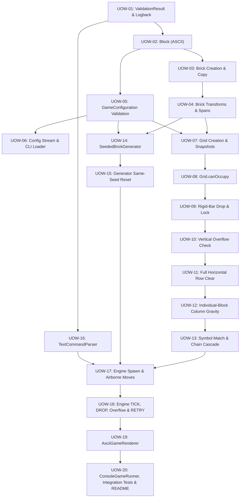

# Atomic Unit-of-Work (`UOW`) TDD Plan & Tracking Matrix: Falling Bricks Console Game (`falling-bricks-game`)

- **Goal**: Build a clean-architecture Java 21 console Falling Bricks game via **20 small, atomic Units of Work (`UOW-01` – `UOW-20`)** grouped into 8 Deliveries (`D1` – `D8`), sized and specified so a lower-thought-level agent can execute each unit mechanically with **zero guesswork** and **strict TDD Tests First (`RED` $\rightarrow$ `Verify RED` $\rightarrow$ `GREEN` $\rightarrow$ `Verify GREEN`)**.
- **Spec**: `openspec/changes/falling-bricks-game/proposal.md` & `openspec/changes/falling-bricks-game/specs/falling-bricks/spec.md`
- **Design & ADR**: `openspec/changes/falling-bricks-game/design.md` & `docs/adr/0001-falling-bricks-architecture-and-decision-matrix.md`
- **Plan Status**: **HOLDING FOR USER REVIEW** (`0 / 20` Units of Work Executed — Awaiting Approval)

---

## 0. Iron Law for Lower-Thought-Level Execution Agents

```text
1. ONE UNIT OF WORK (UOW) AT A TIME: Never combine or skip ahead to future UOWs.
2. TDD TESTS COME FIRST (RED): In every UOW, Step 1 is ALWAYS writing the JUnit 5 + AssertJ test in src/test/java/ (plus only a minimal throwing/empty compile stub in src/main/java/ if a type does not exist yet so the test compiles and fails at runtime).
3. WATCH IT FAIL (VERIFY RED): Run the exact ./gradlew test --tests <Class> command in Step 2 and confirm the test fails on the assertion/stub before writing implementation logic.
4. MINIMAL IMPLEMENTATION (GREEN): Write only the exact signatures and invariants specified in Step 3. Do NOT invent extra methods, fields, or classes.
5. VERIFY & UPDATE MATRIX: Run ./gradlew check in Step 4, run code-review-expert in Step 5, commit in Step 6, and immediately update the Master UOW Tracking Matrix below ([x], Status = DELIVERED, Commit SHA).
```

---

## 1. Master Unit-of-Work (`UOW`) Tracking Matrix (`UOW-01` – `UOW-20`)

| UOW ID | Delivery | Atomic Unit of Work Name | Spec & ADR | Step 1: Test File Written FIRST (`RED`) | Step 3: Production File Implemented (`GREEN`) | Verification Command | Status | Commit SHA |
| :--- | :--- | :--- | :--- | :--- | :--- | :--- | :--- | :--- |
| **UOW-01** | **D1** | Logging Config (`logback.xml`) & `ValidationResult<T>` / `ValidationErrorCode` | `DEC-03`, `DEC-10` | `ValidationResultTest.java` | `logback.xml`, `ValidationErrorCode.java`, `ValidationResult.java` | `./gradlew test --tests com.fallingbricks.domain.ValidationResultTest` | `PENDING` | `—` |
| **UOW-02** | **D1** | Printable 7-Bit ASCII `Block` Record (`0x21..0x7E`) | Req 2.3, `DEC-02` | `BlockTest.java` | `Block.java` | `./gradlew test --tests com.fallingbricks.domain.BlockTest` | `PENDING` | `—` |
| **UOW-03** | **D1** | `Orientation`, `Position` & Immutable 3-Block `Brick` Creation (`List.copyOf`) | Req 2.1, 2.2, 2.4, `DEC-02` | `BrickTest.java` (creation & defensive copy) | `Orientation.java`, `Position.java`, `Brick.java` | `./gradlew test --tests com.fallingbricks.domain.BrickTest` | `PENDING` | `—` |
| **UOW-04** | **D1** | `Brick` Transformations (`toggleOrientation`, `cycleBlocks`) & Span Geometry | Req 2.1, 4.0, `DEC-13` | `BrickTest.java` (transforms & spans) | `Brick.java` | `./gradlew test --tests com.fallingbricks.domain.BrickTest` | `PENDING` | `—` |
| **UOW-05** | **D2** | `GameConfiguration` Record, Bounds (`min>=3`, `max=20`) & Overflow `brickCount` Check | Req 1.1–1.4, 3.2, `DEC-05`, `DEC-09`, `DEC-11` | `GameConfigurationTest.java` (validation) | `GameConfiguration.java` | `./gradlew test --tests com.fallingbricks.config.GameConfigurationTest` | `PENDING` | `—` |
| **UOW-06** | **D2** | `GameConfiguration` Loader from `InputStream` (`Properties`) & CLI Flags | Req 1.0, `DEC-04`, `DEC-11` | `GameConfigurationTest.java` (stream & CLI) | `GameConfiguration.java`, `application.properties` | `./gradlew test --tests com.fallingbricks.config.GameConfigurationTest` | `PENDING` | `—` |
| **UOW-07** | **D3** | Immutable `Grid` Creation, Bounds Check & Defensive `cellsSnapshot()` | Req 1.1–1.5, `DEC-01`, `DEC-09` | `GridTest.java` (bounds & defensive copy) | `Grid.java` | `./gradlew test --tests com.fallingbricks.domain.GridTest` | `PENDING` | `—` |
| **UOW-08** | **D3** | `Grid.canOccupy(Brick, anchorCol, anchorRow)` Bounds & Collision Check | Req 4.0, `DEC-01`, `DEC-13` | `GridTest.java` (`canOccupy` tests) | `Grid.java` | `./gradlew test --tests com.fallingbricks.domain.GridTest` | `PENDING` | `—` |
| **UOW-09** | **D4** | Rigid-Bar Drop (`computeRigidDropRow`, `lockRigidBrick`) for `VERTICAL` & `HORIZONTAL` | Req 4.2, `DEC-07` | `GridTest.java` (rigid-bar drop & bridge) | `Grid.java` | `./gradlew test --tests com.fallingbricks.domain.GridTest` | `PENDING` | `—` |
| **UOW-10** | **D4** | `Grid` Vertical Overflow Detection (`VERTICAL_OVERFLOW`) | Req 6.1, `DEC-09` | `GridTest.java` (vertical overflow) | `Grid.java` | `./gradlew test --tests com.fallingbricks.domain.GridTest` | `PENDING` | `—` |
| **UOW-11** | **D5** | `PlacementOutcome` Record & Full Horizontal Row Clear | Req 5.1, `DEC-08` | `GridTest.java` (full horizontal row clear) | `PlacementOutcome.java`, `Grid.java` | `./gradlew test --tests com.fallingbricks.domain.GridTest` | `PENDING` | `—` |
| **UOW-12** | **D5** | Individual-Block Column Gravity on Stacked Blocks After Row Clear (`Q4`) | Req 5.1, `DEC-08` | `GridTest.java` (individual-block gravity) | `Grid.java` | `./gradlew test --tests com.fallingbricks.domain.GridTest` | `PENDING` | `—` |
| **UOW-13** | **D5** | Horizontal Contiguous Symbol Match (`>=3`) & Multi-Step Chain Cascade | Req 5.2, `DEC-08` | `GridTest.java` (symbol match & cascade) | `Grid.java` | `./gradlew test --tests com.fallingbricks.domain.GridTest` | `PENDING` | `—` |
| **UOW-14** | **D6** | `SpawnedBrick`, `BrickGenerator` Port & `SeededBrickGenerator` (`Random(seed)`) | Req 3.1, `DEC-05`, `DEC-06` | `SeededBrickGeneratorTest.java` (determinism) | `SpawnedBrick.java`, `BrickGenerator.java`, `SeededBrickGenerator.java` | `./gradlew test --tests com.fallingbricks.service.SeededBrickGeneratorTest` | `PENDING` | `—` |
| **UOW-15** | **D6** | `SeededBrickGenerator.resetWithSameSeed()` & `resetWithNewSeed(long)` | Req 3.3, `DEC-05`, `DEC-12` | `SeededBrickGeneratorTest.java` (retry reset) | `SeededBrickGenerator.java` | `./gradlew test --tests com.fallingbricks.service.SeededBrickGeneratorTest` | `PENDING` | `—` |
| **UOW-16** | **D7** | `Command` Enum, `CommandParser` Port & `TextCommandParser` Validation | Req 4.1, `DEC-03` | `TextCommandParserTest.java` | `Command.java`, `CommandParser.java`, `TextCommandParser.java` | `./gradlew test --tests com.fallingbricks.ui.TextCommandParserTest` | `PENDING` | `—` |
| **UOW-17** | **D7** | `GameStatus`, `GameSnapshot` & `FallingBricksEngine` Spawn + Airborne Moves | Req 4.0, `DEC-06` | `FallingBricksEngineTest.java` (moves/orient/cycle) | `GameStatus.java`, `GameSnapshot.java`, `FallingBricksEngine.java` | `./gradlew test --tests com.fallingbricks.service.FallingBricksEngineTest` | `PENDING` | `—` |
| **UOW-18** | **D7** | `FallingBricksEngine` Timer `TICK`, `DROP`, `COMPLETED`, `VERTICAL_OVERFLOW` & `RETRY` | Req 3.3, 4.2, 4.3, 6.1, 6.2 | `FallingBricksEngineTest.java` (tick/drop/retry) | `FallingBricksEngine.java` | `./gradlew test --tests com.fallingbricks.service.FallingBricksEngineTest` | `PENDING` | `—` |
| **UOW-19** | **D8** | `GameRenderer` Port & `AsciiGameRenderer` (Mockups 1–4) | Proposal §2, `DEC-10` | `AsciiGameRendererTest.java` | `GameRenderer.java`, `AsciiGameRenderer.java` | `./gradlew test --tests com.fallingbricks.ui.AsciiGameRendererTest` | `PENDING` | `—` |
| **UOW-20** | **D8** | `ConsoleGameRunner`, `FallingBricksApplication`, Real Integration Tests & `README.md` | All Reqs, Clean Repo | `FallingBricksIntegrationTest.java` (Zero Mocks) | `ConsoleGameRunner.java`, `FallingBricksApplication.java`, `README.md` | `./gradlew check --build-cache --parallel` | `PENDING` | `—` |

---

## 2. Dependency Graph Across Atomic Units of Work



---

## 3. Atomic Unit-of-Work Specifications (For Lower-Thought-Level Execution Agents)

---

### Delivery D1: Logging Setup, Validation Types & Printable 7-Bit ASCII `Block` / `Brick`

#### `UOW-01`: Logging Config (`logback.xml`), `ValidationErrorCode` & `ValidationResult<T>`
- **Blocked by**: None
- **Target Seam**: `com.fallingbricks.domain.ValidationResult`, `com.fallingbricks.domain.ValidationErrorCode`
- **Step-by-Step Execution (TDD Tests First)**:
  - [ ] **Step 1 (`RED` — Write Test First)**:
    1. Add `slf4j = "2.0.16"` and `logback = "1.5.12"` to `gradle/libs.versions.toml` and wire `implementation libs.slf4j.api` and `runtimeOnly libs.logback.classic` in `build.gradle`.
    2. Create `src/main/resources/logback.xml` with a `FILE` appender (`logs/falling-bricks.log` at `DEBUG`) and a `STDERR` appender (`ThresholdFilter` set to `WARN`), so `STDOUT` is never touched by logs.
    3. Create `src/test/java/com/fallingbricks/domain/ValidationResultTest.java` with 3 `@Test` methods:
       - `validResultHoldsValueAndReportsIsValidTrue()`
       - `invalidResultHoldsErrorCodeAndMessageAndReportsIsValidFalse()`
       - `mapTransformsValidValueAndPreservesInvalidError()`
    4. Create minimal compile stubs for `ValidationErrorCode` and `ValidationResult<T>` (`isValid()` returning `false`) so the test compiles.
  - [ ] **Step 2 (`Verify RED`)**: Run `./gradlew test --tests com.fallingbricks.domain.ValidationResultTest` and verify it fails on assertions.
  - [ ] **Step 3 (`GREEN` — Minimal Implementation)**:
    - Implement `enum ValidationErrorCode` in `com.fallingbricks.domain`:
      `EMPTY_INPUT`, `INVALID_SYMBOL`, `INVALID_ORIENTATION`, `INVALID_BRICK_SIZE`, `GRID_TOO_SMALL`, `GRID_TOO_LARGE`, `INSUFFICIENT_BRICK_COUNT`, `INVALID_CONFIGURATION`, `UNKNOWN_COMMAND`, `OUT_OF_BOUNDS_MOVE`, `VERTICAL_OVERFLOW`, `GAME_ALREADY_OVER`.
    - Implement `sealed interface ValidationResult<T> permits ValidationResult.Valid, ValidationResult.Invalid`:
      - `record Valid<T>(T value) implements ValidationResult<T>` (`Objects.requireNonNull(value)`)
      - `record Invalid<T>(ValidationErrorCode errorCode, String message) implements ValidationResult<T>` (`Objects.requireNonNull(errorCode)`, non-blank `message`)
      - Helper methods: `boolean isValid()`, `<R> ValidationResult<R> map(Function<? super T, ? extends R> mapper)`, `static <T> ValidationResult<T> valid(T value)`, `static <T> ValidationResult<T> invalid(ValidationErrorCode code, String message)`.
  - [ ] **Step 4 (`Verify GREEN`)**: Run `./gradlew check --build-cache --parallel` (0 failures, 0 warnings).
  - [ ] **Step 5 (`Review & Commit`)**: Run `code-review-expert` check, commit `feat(domain): deliver UOW-01 logging config and ValidationResult [changes/falling-bricks-game:UOW-01]`, and update `UOW-01` in the Tracking Matrix.

---

#### `UOW-02`: Printable 7-Bit ASCII `Block` Value Record (`0x21..0x7E`)
- **Blocked by**: `UOW-01`
- **Target Seam**: `com.fallingbricks.domain.Block#create(char)`
- **Step-by-Step Execution (TDD Tests First)**:
  - [ ] **Step 1 (`RED` — Write Test First)**:
    1. Create `src/test/java/com/fallingbricks/domain/BlockTest.java` with `@Test` methods:
       - `createsBlockForPrintableAsciiSymbols()` (asserts `'!'` [`0x21`], `'@'`, `'#'`, `'$'`, `'A'`, `'~'` [`0x7E`] return `ValidationResult.Valid<Block>` with matching `symbol()`)
       - `rejectsWhitespaceControlAndNonAsciiCharacters()` (asserts `' '`, `'\t'`, `'\n'`, `'\0'`, `(char) 0x7F`, `'★'`, `'é'` return `ValidationResult.Invalid` with `ValidationErrorCode.INVALID_SYMBOL`)
    2. Create a minimal stub `record Block(char symbol)` whose `Block.create(char)` returns `ValidationResult.invalid(ValidationErrorCode.INVALID_SYMBOL, "stub")`.
  - [ ] **Step 2 (`Verify RED`)**: Run `./gradlew test --tests com.fallingbricks.domain.BlockTest` and verify `createsBlockForPrintableAsciiSymbols` fails.
  - [ ] **Step 3 (`GREEN` — Minimal Implementation)**:
    - In `src/main/java/com/fallingbricks/domain/Block.java`:
      - `public static boolean isValidAsciiSymbol(char symbol) { return symbol >= 0x21 && symbol <= 0x7E; }`
      - Compact constructor throws `IllegalArgumentException` if `!isValidAsciiSymbol(symbol)`.
      - `public static ValidationResult<Block> create(char symbol)` returns `Valid(new Block(symbol))` if valid, else `Invalid(ValidationErrorCode.INVALID_SYMBOL, ...)`.
  - [ ] **Step 4 (`Verify GREEN`)**: Run `./gradlew check --build-cache --parallel`.
  - [ ] **Step 5 (`Review & Commit`)**: Run `code-review-expert` check, commit `[changes/falling-bricks-game:UOW-02]`, and update `UOW-02` in the Tracking Matrix.

---

#### `UOW-03`: `Orientation`, `Position` & Immutable 3-Block `Brick` Creation (`List.copyOf`)
- **Blocked by**: `UOW-02`
- **Target Seam**: `com.fallingbricks.domain.Brick#create(List<Block>, Orientation)`
- **Step-by-Step Execution (TDD Tests First)**:
  - [ ] **Step 1 (`RED` — Write Test First)**:
    1. Create `src/test/java/com/fallingbricks/domain/BrickTest.java` with `@Test` methods:
       - `createsValidThreeBlockBrickInHorizontalAndVerticalOrientations()`
       - `defensivelyCopiesCallerBlockListAndPreventsExternalMutation()` (passes a mutable `ArrayList<Block>`, mutates the `ArrayList` after `Brick.create`, asserts `brick.blocks()` is unchanged, and asserts `brick.blocks().add(...)` throws `UnsupportedOperationException`)
       - `rejectsNullOrWrongSizedBlockLists()` (`null`, empty, 2 blocks, 4 blocks, or list containing `null` element $\rightarrow$ `ValidationErrorCode.INVALID_BRICK_SIZE`)
       - `rejectsNullOrientation()` (`null` orientation $\rightarrow$ `ValidationErrorCode.INVALID_ORIENTATION`)
    2. Create `enum Orientation { HORIZONTAL, VERTICAL }`, `record Position(int col, int row)`, and a compile stub for `Brick`.
  - [ ] **Step 2 (`Verify RED`)**: Run `./gradlew test --tests com.fallingbricks.domain.BrickTest` and confirm failure.
  - [ ] **Step 3 (`GREEN` — Minimal Implementation)**:
    - Implement `record Brick(List<Block> blocks, Orientation orientation)` with `public static final int REQUIRED_BLOCKS = 3;`:
      - Compact constructor enforces non-null `orientation`, non-null `blocks` with no null elements and `blocks.size() == REQUIRED_BLOCKS`, and assigns `blocks = List.copyOf(blocks)`.
      - `public static ValidationResult<Brick> create(List<Block> blocks, Orientation orientation)` validates inputs and returns `Valid(new Brick(blocks, orientation))` or `Invalid(INVALID_ORIENTATION / INVALID_BRICK_SIZE, ...)`.
  - [ ] **Step 4 (`Verify GREEN`)**: Run `./gradlew check --build-cache --parallel`.
  - [ ] **Step 5 (`Review & Commit`)**: Run `code-review-expert` check, commit `[changes/falling-bricks-game:UOW-03]`, and update `UOW-03` in the Tracking Matrix.

---

#### `UOW-04`: `Brick` Transformations (`toggleOrientation`, `cycleBlocks`) & Span Geometry (`widthSpan`, `heightSpan`, `occupiedPositions`)
- **Blocked by**: `UOW-03`
- **Target Seam**: `Brick#toggleOrientation`, `Brick#cycleBlocks`, `Brick#widthSpan`, `Brick#heightSpan`, `Brick#occupiedPositions`
- **Step-by-Step Execution (TDD Tests First)**:
  - [ ] **Step 1 (`RED` — Write Test First)**:
    1. Add `@Test` methods to `src/test/java/com/fallingbricks/domain/BrickTest.java`:
       - `toggleOrientationSwitchesBetweenHorizontalAndVerticalPreservingBlocks()`
       - `cycleBlocksShiftsLastBlockToFirstPosition()` (verifies `[A, B, C]` $\rightarrow$ `[C, A, B]` and 3 cycles restore `[A, B, C]`)
       - `computesWidthAndHeightSpanAndOccupiedPositionsForHorizontalAndVertical()` (for `HORIZONTAL` at `(col=1, row=5)`: `widthSpan()==3, heightSpan()==1`, positions `[(1,5), (2,5), (3,5)]`; for `VERTICAL` at `(col=2, row=4)`: `widthSpan()==1, heightSpan()==3`, positions `[(2,4), (2,5), (2,6)]`).
    2. Add stub methods on `Brick` returning dummy values.
  - [ ] **Step 2 (`Verify RED`)**: Run `./gradlew test --tests com.fallingbricks.domain.BrickTest` and confirm new tests fail.
  - [ ] **Step 3 (`GREEN` — Minimal Implementation)**:
    - Implement on `Brick`:
      - `public Brick toggleOrientation()`
      - `public Brick cycleBlocks()` (`List.of(blocks.get(2), blocks.get(0), blocks.get(1))`)
      - `public int widthSpan()` (`orientation == HORIZONTAL ? blocks.size() : 1`)
      - `public int heightSpan()` (`orientation == VERTICAL ? blocks.size() : 1`)
      - `public List<Position> occupiedPositions(int anchorCol, int anchorRow)`
  - [ ] **Step 4 (`Verify GREEN`)**: Run `./gradlew check --build-cache --parallel`.
  - [ ] **Step 5 (`Review & Commit`)**: Run `code-review-expert` check, commit `[changes/falling-bricks-game:UOW-04]`, and update `UOW-04` (and Delivery `D1`) in the Tracking Matrix.

---

### Delivery D2: Configurable Parameters (`GameConfiguration`) & Overflow-Capable Queue Bounds

#### `UOW-05`: `GameConfiguration` Record, Grid Bounds (`min >= 3`, `max` default `20x20`) & Overflow-Capable `brickCount` Validation
- **Blocked by**: `UOW-02`
- **Target Seam**: `com.fallingbricks.config.GameConfiguration#create`
- **Step-by-Step Execution (TDD Tests First)**:
  - [ ] **Step 1 (`RED` — Write Test First)**:
    1. Create `src/test/java/com/fallingbricks/config/GameConfigurationTest.java` with `@Test` methods:
       - `defaultsProvideValidConfiguration()` (`width=6, height=12, maxWidth=20, maxHeight=20, brickCount=15, tickIntervalMs=1000, symbols="@#$%&", maxBrickSpan=3`)
       - `rejectsNegativeZeroOrUndersizedGridDimensions()` (`width` or `height` `<= 0` or `< 3` $\rightarrow$ `ValidationErrorCode.GRID_TOO_SMALL`)
       - `rejectsGridDimensionsExceedingConfiguredMaximumAndAllowsCustomMaximum()` (`width=21` with default `maxWidth=20` $\rightarrow$ `GRID_TOO_LARGE`; `width=25` with `maxWidth=30` $\rightarrow$ `Valid`)
       - `rejectsBrickCountTooSmallToOverflowGridHeight()` (`height=12, maxBrickSpan=3` requires `brickCount >= (12 / 3) + 1 = 5`; `brickCount=4` $\rightarrow$ `INSUFFICIENT_BRICK_COUNT`; `brickCount=5` $\rightarrow$ `Valid`)
       - `rejectsInvalidAsciiSymbolsOrNegativeTickInterval()` (symbols with whitespace/non-ASCII or `< 2` distinct symbols $\rightarrow$ `INVALID_SYMBOL`; `tickIntervalMs < 0` $\rightarrow$ `INVALID_CONFIGURATION`)
    2. Create a minimal compile stub for `GameConfiguration`.
  - [ ] **Step 2 (`Verify RED`)**: Run `./gradlew test --tests com.fallingbricks.config.GameConfigurationTest` and confirm failure.
  - [ ] **Step 3 (`GREEN` — Minimal Implementation)**:
    - Implement `record GameConfiguration(int width, int height, int maxWidth, int maxHeight, int brickCount, long seed, long tickIntervalMs, String symbols, int maxBrickSpan)` in `com.fallingbricks.config` with `create(...)` returning `ValidationResult<GameConfiguration>` and `defaults(long seed)` / `defaults()`.
  - [ ] **Step 4 (`Verify GREEN`)**: Run `./gradlew check --build-cache --parallel`.
  - [ ] **Step 5 (`Review & Commit`)**: Run `code-review-expert` check, commit `[changes/falling-bricks-game:UOW-05]`, and update `UOW-05` in the Tracking Matrix.

---

#### `UOW-06`: `GameConfiguration` Loader from `InputStream` (`Properties`) & CLI Flags (`--width`, `--height`, `--bricks`, `--seed`, etc.)
- **Blocked by**: `UOW-05`
- **Target Seam**: `GameConfiguration#fromPropertiesAndArgs(InputStream, String[])`
- **Step-by-Step Execution (TDD Tests First)**:
  - [ ] **Step 1 (`RED` — Write Test First)**:
    1. Add `@Test` methods to `src/test/java/com/fallingbricks/config/GameConfigurationTest.java`:
       - `loadsOverridesFromPropertiesInputStream()` (passes a `ByteArrayInputStream` with `game.grid.width=8`, `game.grid.height=15`, `game.bricks.count=10`, `game.random.seed=999`, `game.timer.tickMs=500`, `game.bricks.symbols=!@#` and asserts all fields match)
       - `cliFlagsOverridePropertiesStreamValues()` (passes `--width=10`, `--height=18`, `--max-width=25`, `--max-height=25`, `--bricks=12`, `--seed=42`, `--tick-ms=250`, `--symbols=$%^` and asserts CLI flags win)
       - `rejectsMalformedNumericPropertiesOrUnknownCliFlags()` (e.g., `--width=abc` or `--unknown=1` $\rightarrow$ `ValidationErrorCode.INVALID_CONFIGURATION`)
    2. Add stub method `fromPropertiesAndArgs(InputStream, String[])` on `GameConfiguration`.
  - [ ] **Step 2 (`Verify RED`)**: Run `./gradlew test --tests com.fallingbricks.config.GameConfigurationTest` and confirm failure.
  - [ ] **Step 3 (`GREEN` — Minimal Implementation)**:
    - Implement `fromPropertiesAndArgs(InputStream propertiesStream, String[] cliArgs)` and `fromClasspathAndArgs(String[] cliArgs)` (using `GameConfiguration.class.getResourceAsStream("/application.properties")` — zero hardcoded file paths).
    - Create `src/main/resources/application.properties` with the documented defaults.
  - [ ] **Step 4 (`Verify GREEN`)**: Run `./gradlew check --build-cache --parallel`.
  - [ ] **Step 5 (`Review & Commit`)**: Run `code-review-expert` check, commit `[changes/falling-bricks-game:UOW-06]`, and update `UOW-06` (and Delivery `D2`) in the Tracking Matrix.

---

### Delivery D3: Immutable `Grid` Value Object & Defensive State Snapshots

#### `UOW-07`: Immutable `Grid` Creation, Bounds Check (`[3..maxWidth] x [3..maxHeight]`) & Defensive `cellsSnapshot()`
- **Blocked by**: `UOW-04`, `UOW-05`
- **Target Seam**: `com.fallingbricks.domain.Grid#create`, `Grid#cellAt`, `Grid#cellsSnapshot`
- **Step-by-Step Execution (TDD Tests First)**:
  - [ ] **Step 1 (`RED` — Write Test First)**:
    1. Create `src/test/java/com/fallingbricks/domain/GridTest.java` with `@Test` methods:
       - `createsEmptyGridWithinValidBounds()` (`Grid.create(6, 12)` and `Grid.create(20, 20)` return `Valid<Grid>` with all cells `Optional.empty()`)
       - `rejectsNegativeZeroUndersizedAndOversizedGrids()` (`Grid.create(-1, 10)`, `Grid.create(0, 10)`, `Grid.create(2, 10)` $\rightarrow$ `GRID_TOO_SMALL`; `Grid.create(21, 10)` $\rightarrow$ `GRID_TOO_LARGE`)
       - `cellsSnapshotReturnsDefensiveCopyThatCannotMutateGrid()` (mutates the returned `Block[][]` array and asserts `grid.cellAt(0, 0)` remains `Optional.empty()`)
    2. Create a minimal compile stub for `Grid` in `com.fallingbricks.domain`.
  - [ ] **Step 2 (`Verify RED`)**: Run `./gradlew test --tests com.fallingbricks.domain.GridTest` and confirm failure.
  - [ ] **Step 3 (`GREEN` — Minimal Implementation)**:
    - Implement `final class Grid` with private `final int width`, `final int height`, and `private final Block[][] cells` (`cells[row][col]` where `row=0` is floor and `row=height-1` is top).
    - Implement `Grid.create(int width, int height)` (using default max `20x20`) and `Grid.create(int width, int height, int maxWidth, int maxHeight)`.
    - Implement `Optional<Block> cellAt(int col, int row)` and defensive `Block[][] cellsSnapshot()`.
  - [ ] **Step 4 (`Verify GREEN`)**: Run `./gradlew check --build-cache --parallel`.
  - [ ] **Step 5 (`Review & Commit`)**: Run `code-review-expert` check, commit `[changes/falling-bricks-game:UOW-07]`, and update `UOW-07` in the Tracking Matrix.

---

#### `UOW-08`: `Grid.canOccupy(Brick, anchorCol, anchorRow)` Bounds & Collision Check
- **Blocked by**: `UOW-07`
- **Target Seam**: `Grid#canOccupy(Brick, int, int)`, `Grid#withBlock(int, int, Block)`
- **Step-by-Step Execution (TDD Tests First)**:
  - [ ] **Step 1 (`RED` — Write Test First)**:
    1. Add `@Test` methods to `src/test/java/com/fallingbricks/domain/GridTest.java`:
       - `canOccupyReturnsTrueWhenAllBrickPositionsAreInBoundsAndEmpty()`
       - `canOccupyReturnsFalseWhenHorizontalOrVerticalBrickExtendsOutOfBounds()` (`col < 0`, `col + widthSpan > width`, `row < 0`, `row + heightSpan > height`)
       - `canOccupyReturnsFalseWhenAnyBrickPositionIsOccupied()`
    2. Add stub `canOccupy` and package/test helper `withBlock(int col, int row, Block block)` returning a new `Grid`.
  - [ ] **Step 2 (`Verify RED`)**: Run `./gradlew test --tests com.fallingbricks.domain.GridTest` and confirm failure.
  - [ ] **Step 3 (`GREEN` — Minimal Implementation)**:
    - Implement `public boolean isInBounds(int col, int row)`, `public Grid withBlock(int col, int row, Block block)` (returning a new `Grid` with cloned `Block[][]`), and `public boolean canOccupy(Brick brick, int anchorCol, int anchorRow)` iterating over `brick.occupiedPositions(anchorCol, anchorRow)`.
  - [ ] **Step 4 (`Verify GREEN`)**: Run `./gradlew check --build-cache --parallel`.
  - [ ] **Step 5 (`Review & Commit`)**: Run `code-review-expert` check, commit `[changes/falling-bricks-game:UOW-08]`, and update `UOW-08` (and Delivery `D3`) in the Tracking Matrix.

---

### Delivery D4: Rigid-Bar Airborne Drop Physics (`Q3`) & Vertical Overflow Detection (`Q5`)

#### `UOW-09`: Rigid-Bar Drop (`computeRigidDropRow`, `lockRigidBrick`) for `VERTICAL` & `HORIZONTAL` Bricks (`Q3`)
- **Blocked by**: `UOW-08`
- **Target Seam**: `Grid#computeRigidDropRow(Brick, int, int)`, `Grid#lockRigidBrick(Brick, int, int)`
- **Step-by-Step Execution (TDD Tests First)**:
  - [ ] **Step 1 (`RED` — Write Test First)**:
    1. Add `@Test` methods to `src/test/java/com/fallingbricks/domain/GridTest.java`:
       - `dropsVerticalBrickToFloorAndOntoExistingStack()` (`VERTICAL` `[@, #, $]` dropped in empty `col=2` from `row=9` locks at `(2,0)='@', (2,1)='#', (2,2)='$'`; second `VERTICAL` brick in `col=2` locks at `rows 3..5`)
       - `dropsHorizontalBrickAsRigidBarOverUnevenStackCreatingBridge()` (`Scenario 4.2`: `col=1` has blocks up to `row=2`, while `cols=2,3` are empty; `HORIZONTAL` `[@, #, $]` at `cols 1..3` dropped from `row=11` stops as a rigid horizontal bar at `row=3`, locking `(1,3)='@', (2,3)='#', (3,3)='$'` with `(2,0..2)` and `(3,0..2)` remaining empty!)
    2. Add stub methods `computeRigidDropRow` and `lockRigidBrick` on `Grid`.
  - [ ] **Step 2 (`Verify RED`)**: Run `./gradlew test --tests com.fallingbricks.domain.GridTest` and confirm failure.
  - [ ] **Step 3 (`GREEN` — Minimal Implementation)**:
    - Implement `public ValidationResult<Integer> computeRigidDropRow(Brick brick, int anchorCol, int startRow)` (decrements `targetRow` from `startRow` while `canOccupy(brick, anchorCol, targetRow - 1)` is `true`).
    - Implement `public ValidationResult<Grid> lockRigidBrick(Brick brick, int anchorCol, int anchorRow)` placing all 3 blocks into a new `Grid`.
  - [ ] **Step 4 (`Verify GREEN`)**: Run `./gradlew check --build-cache --parallel`.
  - [ ] **Step 5 (`Review & Commit`)**: Run `code-review-expert` check, commit `[changes/falling-bricks-game:UOW-09]`, and update `UOW-09` in the Tracking Matrix.

---

#### `UOW-10`: `Grid` Vertical Overflow Detection (`ValidationErrorCode.VERTICAL_OVERFLOW`) (`Q5`)
- **Blocked by**: `UOW-09`
- **Target Seam**: `Grid#computeRigidDropRow`, `Grid#lockRigidBrick`
- **Step-by-Step Execution (TDD Tests First)**:
  - [ ] **Step 1 (`RED` — Write Test First)**:
    1. Add `@Test` methods to `src/test/java/com/fallingbricks/domain/GridTest.java`:
       - `returnsVerticalOverflowWhenSpawnOrLockPositionOverlapsOccupiedTopCell()` (`Scenario 6.1`: on a `6x6` grid where `(2, 5)` is occupied, attempting `lockRigidBrick` or `computeRigidDropRow` at `(col=2, row=5)` returns `ValidationResult.Invalid(ValidationErrorCode.VERTICAL_OVERFLOW)`)
       - `returnsVerticalOverflowWhenVerticalBrickExceedsTopOfGrid()` (attempting to lock a `VERTICAL` brick at `anchorRow = height - 2` where top block would be at `row = height` returns `ValidationErrorCode.VERTICAL_OVERFLOW`)
  - [ ] **Step 2 (`Verify RED`)**: Run `./gradlew test --tests com.fallingbricks.domain.GridTest` and confirm failure.
  - [ ] **Step 3 (`GREEN` — Minimal Implementation)**:
    - Update `computeRigidDropRow` and `lockRigidBrick` so that if any occupied position has `row >= height` or collides at spawn/lock time, it returns `ValidationResult.invalid(ValidationErrorCode.VERTICAL_OVERFLOW, ...)`. (Lateral `col < 0` or `col >= width` returns `OUT_OF_BOUNDS_MOVE`.)
  - [ ] **Step 4 (`Verify GREEN`)**: Run `./gradlew check --build-cache --parallel`.
  - [ ] **Step 5 (`Review & Commit`)**: Run `code-review-expert` check, commit `[changes/falling-bricks-game:UOW-10]`, and update `UOW-10` (and Delivery `D4`) in the Tracking Matrix.

---

### Delivery D5: Horizontal Row Clearing / Matching & Individual-Block Gravity Cascade (`Q4`)

#### `UOW-11`: `PlacementOutcome` Record & Full Horizontal Row Clear
- **Blocked by**: `UOW-10`
- **Target Seam**: `com.fallingbricks.domain.PlacementOutcome`, `Grid#resolveClearsAndGravity()`
- **Step-by-Step Execution (TDD Tests First)**:
  - [ ] **Step 1 (`RED` — Write Test First)**:
    1. Create `record PlacementOutcome(Grid grid, int rowsOrMatchesCleared, int blocksCleared, int chainCount, int pointsEarned)` in `com.fallingbricks.domain`.
    2. Add `@Test` method to `src/test/java/com/fallingbricks/domain/GridTest.java`:
       - `clearsCompletelyFullHorizontalRowAndAwardsPoints()` (fills all 6 columns `0..5` of `row=0` with non-matching distinct symbols `@ # $ % & @` so only the full-row rule triggers; calls `grid.resolveClearsAndGravity()` and asserts `row=0` is now completely empty, `rowsOrMatchesCleared() == 1`, `blocksCleared() == 6`, `chainCount() == 1`, `pointsEarned() == 600`).
    3. Add stub `resolveClearsAndGravity()` returning `new PlacementOutcome(this, 0, 0, 0, 0)`.
  - [ ] **Step 2 (`Verify RED`)**: Run `./gradlew test --tests com.fallingbricks.domain.GridTest` and confirm failure.
  - [ ] **Step 3 (`GREEN` — Minimal Implementation)**:
    - Implement full horizontal row detection in `Grid.resolveClearsAndGravity()` (any row `r` where all `0..width-1` cells are non-null clears all cells in row `r` and computes `PlacementOutcome`).
  - [ ] **Step 4 (`Verify GREEN`)**: Run `./gradlew check --build-cache --parallel`.
  - [ ] **Step 5 (`Review & Commit`)**: Run `code-review-expert` check, commit `[changes/falling-bricks-game:UOW-11]`, and update `UOW-11` in the Tracking Matrix.

---

#### `UOW-12`: Individual-Block Column Gravity on Stacked Blocks After Row Clear (`Q4`)
- **Blocked by**: `UOW-11`
- **Target Seam**: `Grid#resolveClearsAndGravity()`
- **Step-by-Step Execution (TDD Tests First)**:
  - [ ] **Step 1 (`RED` — Write Test First)**:
    1. Add `@Test` method to `src/test/java/com/fallingbricks/domain/GridTest.java`:
       - `stackedBlocksAboveClearedRowDropIndependentlyByColumnGravityLosingOriginalBrickShape()` (`Scenario 5.1` / Review Focus #4: Lock a rigid `HORIZONTAL` brick `[@, #, $]` at `row=2, cols=1..3` supported only at `(1,1)='%'` while `(2,1)` and `(3,1)` are empty; fill `row=0` across `cols 0..5` and call `resolveClearsAndGravity()`; assert that after `row=0` clears, `(1,1)='%'` drops to `(1,0)`, `(1,2)='@'` drops to `(1,1)`, while overhanging `(2,2)='#'` drops all the way to the floor at `(2,0)` and `(3,2)='$'` drops all the way to the floor at `(3,0)`!).
  - [ ] **Step 2 (`Verify RED`)**: Run `./gradlew test --tests com.fallingbricks.domain.GridTest` and confirm failure.
  - [ ] **Step 3 (`GREEN` — Minimal Implementation)**:
    - In `Grid.resolveClearsAndGravity()`, after removing cleared cells in a step, compact each column `c` (`0 .. width - 1`) independently from `row = 0` upward so every surviving block falls straight down to the lowest available row in its column.
  - [ ] **Step 4 (`Verify GREEN`)**: Run `./gradlew check --build-cache --parallel`.
  - [ ] **Step 5 (`Review & Commit`)**: Run `code-review-expert` check, commit `[changes/falling-bricks-game:UOW-12]`, and update `UOW-12` in the Tracking Matrix.

---

#### `UOW-13`: Horizontal Contiguous Symbol Match (`>= 3` in a Row) & Multi-Step Chain Cascade
- **Blocked by**: `UOW-12`
- **Target Seam**: `Grid#resolveClearsAndGravity()`, `Grid#dropAndResolve(Brick, int, int)`
- **Step-by-Step Execution (TDD Tests First)**:
  - [ ] **Step 1 (`RED` — Write Test First)**:
    1. Add `@Test` methods to `src/test/java/com/fallingbricks/domain/GridTest.java`:
       - `clearsHorizontalContiguousRunOfThreeOrMoreIdenticalSymbolsInPartiallyFilledRow()` (places `'@'` at `(1,0), (2,0), (3,0)` on a width-6 grid with `(0,0), (4,0), (5,0)` empty; asserts all 3 `'@'` blocks clear)
       - `cascadesMultipleChainStepsWhenGravityCreatesNewHorizontalMatch()` (`Scenario 5.2`: clearing a horizontal match at `row=0` causes blocks above to fall via individual column gravity and form a second horizontal match `['#', '#', '#']` at `row=0`; asserts both clear in a single call with `chainCount() == 2` and chain multiplier applied to `pointsEarned()`).
  - [ ] **Step 2 (`Verify RED`)**: Run `./gradlew test --tests com.fallingbricks.domain.GridTest` and confirm failure.
  - [ ] **Step 3 (`GREEN` — Minimal Implementation)**:
    - Add horizontal contiguous symbol run detection (`>= 3` identical symbols in any row `r`) alongside full-row detection inside the `while (true)` cascade loop of `resolveClearsAndGravity()`, and add convenience method `ValidationResult<PlacementOutcome> dropAndResolve(Brick brick, int anchorCol, int startRow)`.
  - [ ] **Step 4 (`Verify GREEN`)**: Run `./gradlew check --build-cache --parallel`.
  - [ ] **Step 5 (`Review & Commit`)**: Run `code-review-expert` check, commit `[changes/falling-bricks-game:UOW-13]`, and update `UOW-13` (and Delivery `D5`) in the Tracking Matrix.

---

### Delivery D6: Deterministic `SeededBrickGenerator` (`Random(seed)`) & Same-Seed Reset (`Q1` & `Q2`)

#### `UOW-14`: `SpawnedBrick`, `BrickGenerator` Port & Deterministic `SeededBrickGenerator` (`Random(seed)`)
- **Blocked by**: `UOW-04`, `UOW-05`
- **Target Seam**: `com.fallingbricks.port.BrickGenerator`, `com.fallingbricks.service.SeededBrickGenerator`
- **Step-by-Step Execution (TDD Tests First)**:
  - [ ] **Step 1 (`RED` — Write Test First)**:
    1. Create `record SpawnedBrick(Brick brick, int spawnCol)` and `interface BrickGenerator` in `com.fallingbricks.port`.
    2. Create `src/test/java/com/fallingbricks/service/SeededBrickGeneratorTest.java` with `@Test` methods:
       - `twoGeneratorsWithSameSeedProduceIdenticalSequenceOfBricksAndSpawnColumns()` (`Scenario 3.1`: initializes two generators with `seed=987654321L, brickCount=15, gridWidth=6, symbols="@#$%&"` and asserts all 15 `SpawnedBrick` items are identical)
       - `spawnColumnAlwaysFitsBrickWidthSpanWithinGridWidth()` (for `HORIZONTAL` bricks on `width=6`, `0 <= spawnCol <= 3`; for `VERTICAL` bricks on `width=6`, `0 <= spawnCol <= 5`)
       - `exhaustsQueueAfterConfiguredBrickCount()` (`remainingCount()` counts down from `brickCount` to `0`, then `nextSpawnedBrick()` returns `Optional.empty()`).
    3. Create a minimal stub `SeededBrickGenerator`.
  - [ ] **Step 2 (`Verify RED`)**: Run `./gradlew test --tests com.fallingbricks.service.SeededBrickGeneratorTest` and confirm failure.
  - [ ] **Step 3 (`GREEN` — Minimal Implementation)**:
    - Implement `SeededBrickGenerator` using `new java.util.Random(seed)` to pre-generate (or deterministically stream) `brickCount` `SpawnedBrick` instances with `peekNext()`, `nextSpawnedBrick()`, `remainingCount()`, and `seed()`.
  - [ ] **Step 4 (`Verify GREEN`)**: Run `./gradlew check --build-cache --parallel`.
  - [ ] **Step 5 (`Review & Commit`)**: Run `code-review-expert` check, commit `[changes/falling-bricks-game:UOW-14]`, and update `UOW-14` in the Tracking Matrix.

---

#### `UOW-15`: `SeededBrickGenerator.resetWithSameSeed()` & `resetWithNewSeed(long)` (`Q1`)
- **Blocked by**: `UOW-14`
- **Target Seam**: `BrickGenerator#resetWithSameSeed`, `BrickGenerator#resetWithNewSeed`
- **Step-by-Step Execution (TDD Tests First)**:
  - [ ] **Step 1 (`RED` — Write Test First)**:
    1. Add `@Test` methods to `src/test/java/com/fallingbricks/service/SeededBrickGeneratorTest.java`:
       - `resetWithSameSeedReproducesExactSameLevelSequence()` (`Scenario 3.3`: consumes 5 bricks, calls `resetWithSameSeed()`, asserts `remainingCount() == brickCount`, `seed()` is unchanged, and the newly drawn sequence equals the original run)
       - `resetWithNewSeedUpdatesSeedAndProducesNewDeterministicSequence()`
  - [ ] **Step 2 (`Verify RED`)**: Run `./gradlew test --tests com.fallingbricks.service.SeededBrickGeneratorTest` and confirm failure.
  - [ ] **Step 3 (`GREEN` — Minimal Implementation)**:
    - Implement `resetWithSameSeed()` and `resetWithNewSeed(long newSeed)` on `SeededBrickGenerator`.
  - [ ] **Step 4 (`Verify GREEN`)**: Run `./gradlew check --build-cache --parallel`.
  - [ ] **Step 5 (`Review & Commit`)**: Run `code-review-expert` check, commit `[changes/falling-bricks-game:UOW-15]`, and update `UOW-15` (and Delivery `D6`) in the Tracking Matrix.

---

### Delivery D7: `TextCommandParser` & `FallingBricksEngine` State Machine

#### `UOW-16`: `Command` Enum, `CommandParser` Port & `TextCommandParser` Validation
- **Blocked by**: `UOW-01`
- **Target Seam**: `com.fallingbricks.ui.TextCommandParser#parse(String)`
- **Step-by-Step Execution (TDD Tests First)**:
  - [ ] **Step 1 (`RED` — Write Test First)**:
    1. Create `enum Command { LEFT, RIGHT, ORIENT, CYCLE, DROP, TICK, RETRY, NEW_GAME, QUIT }` in `com.fallingbricks.domain` and `interface CommandParser` in `com.fallingbricks.port`.
    2. Create `src/test/java/com/fallingbricks/ui/TextCommandParserTest.java` with `@Test` methods:
       - `parsesShortAndFullCommandsCaseInsensitivelyWithTrimming()` (`"L"`, `"left"`, `" R "`, `"O"`, `"orient"`, `"C"`, `"cycle"`, `"D"`, `"drop"`, `"T"`, `"tick"`, `"retry"`, `"N"`, `"new"`, `"Q"`, `"quit"`)
       - `rejectsNullEmptyAndWhitespaceOnlyInputs()` (`null`, `""`, `"   "` $\rightarrow$ `ValidationErrorCode.EMPTY_INPUT`)
       - `rejectsUnknownAndDodgyCommandInputs()` (`"JUMP"`, `"L R"`, `"123"`, `"@"` $\rightarrow$ `ValidationErrorCode.UNKNOWN_COMMAND`)
    3. Create a minimal stub `TextCommandParser`.
  - [ ] **Step 2 (`Verify RED`)**: Run `./gradlew test --tests com.fallingbricks.ui.TextCommandParserTest` and confirm failure.
  - [ ] **Step 3 (`GREEN` — Minimal Implementation)**:
    - Implement `TextCommandParser` in `com.fallingbricks.ui`.
  - [ ] **Step 4 (`Verify GREEN`)**: Run `./gradlew check --build-cache --parallel`.
  - [ ] **Step 5 (`Review & Commit`)**: Run `code-review-expert` check, commit `[changes/falling-bricks-game:UOW-16]`, and update `UOW-16` in the Tracking Matrix.

---

#### `UOW-17`: `GameStatus`, `GameSnapshot` & `FallingBricksEngine` Top-Row Spawn + Airborne Commands (`LEFT`, `RIGHT`, `ORIENT`, `CYCLE`)
- **Blocked by**: `UOW-13`, `UOW-15`, `UOW-16`
- **Target Seam**: `com.fallingbricks.service.FallingBricksEngine#snapshot`, `FallingBricksEngine#execute`
- **Step-by-Step Execution (TDD Tests First)**:
  - [ ] **Step 1 (`RED` — Write Test First)**:
    1. Create `enum GameStatus { ACTIVE, COMPLETED, GAME_OVER, QUIT }` and `record GameSnapshot(...)` in `com.fallingbricks.domain`.
    2. Create `src/test/java/com/fallingbricks/service/FallingBricksEngineTest.java` with `@Test` methods:
       - `spawnsFirstBrickAtTopOfGridWithActiveStatus()` (`anchorRow == height - 1` for `HORIZONTAL`, `height - 3` for `VERTICAL`)
       - `movesActiveBrickLeftAndRightWithinGridBounds()`
       - `rejectsOutOfBoundsLateralMoveWithoutMutatingSnapshot()` (moving a `HORIZONTAL` brick at `col=0` left or `col=width-3` right returns `ValidationErrorCode.OUT_OF_BOUNDS_MOVE` and keeps `activeCol` unchanged)
       - `togglesOrientationAndCyclesBlocksInAirWhenInBoundsAndRejectsOutOfBoundsOrientationToggle()`
    3. Create a minimal stub `FallingBricksEngine`.
  - [ ] **Step 2 (`Verify RED`)**: Run `./gradlew test --tests com.fallingbricks.service.FallingBricksEngineTest` and confirm failure.
  - [ ] **Step 3 (`GREEN` — Minimal Implementation)**:
    - Implement initial top-row brick spawn and `LEFT`, `RIGHT`, `ORIENT`, `CYCLE`, `QUIT` command handling in `FallingBricksEngine`.
  - [ ] **Step 4 (`Verify GREEN`)**: Run `./gradlew check --build-cache --parallel`.
  - [ ] **Step 5 (`Review & Commit`)**: Run `code-review-expert` check, commit `[changes/falling-bricks-game:UOW-17]`, and update `UOW-17` in the Tracking Matrix.

---

#### `UOW-18`: `FallingBricksEngine` Timer `TICK`, Instant `DROP`, `COMPLETED`, `VERTICAL_OVERFLOW` (`GAME_OVER`), Same-Seed `RETRY` & SLF4J Logging
- **Blocked by**: `UOW-17`
- **Target Seam**: `FallingBricksEngine#execute(Command)`
- **Step-by-Step Execution (TDD Tests First)**:
  - [ ] **Step 1 (`RED` — Write Test First)**:
    1. Add `@Test` methods to `src/test/java/com/fallingbricks/service/FallingBricksEngineTest.java`:
       - `tickMovesActiveBrickDownOneRowAndLocksWhenContactingFloorOrStack()` (`Scenario 4.3`)
       - `dropImmediatelyLocksRigidBrickResolvesClearsAndTransitionsToCompletedWhenQueueExhausted()` (`Scenario 6.2`)
       - `transitionsToGameOverWithVerticalOverflowWhenTopSpawnPositionsAreOccupied()` (`Scenario 6.1`)
       - `retryResetsBoardAndReplaysExactSameLevelWithSameSeed()` (`Scenario 3.3`: plays several moves, executes `Command.RETRY`, asserts `grid` is empty, `score == 0`, `status == ACTIVE`, `seed` is identical, and the spawned brick sequence matches the initial run).
  - [ ] **Step 2 (`Verify RED`)**: Run `./gradlew test --tests com.fallingbricks.service.FallingBricksEngineTest` and confirm failure.
  - [ ] **Step 3 (`GREEN` — Minimal Implementation)**:
    - Implement `Command.TICK`, `Command.DROP`, `Command.RETRY`, `Command.NEW_GAME`, `VERTICAL_OVERFLOW` transition to `GameStatus.GAME_OVER`, queue exhaustion transition to `GameStatus.COMPLETED`, and SLF4J logging (`INFO`, `DEBUG`, `WARN`) in `FallingBricksEngine`.
  - [ ] **Step 4 (`Verify GREEN`)**: Run `./gradlew check --build-cache --parallel`.
  - [ ] **Step 5 (`Review & Commit`)**: Run `code-review-expert` check, commit `[changes/falling-bricks-game:UOW-18]`, and update `UOW-18` (and Delivery `D7`) in the Tracking Matrix.

---

### Delivery D8: Console UI, Real Multi-Component Integration Suite & Maintainer `README.md`

#### `UOW-19`: `GameRenderer` Port & `AsciiGameRenderer` Matching Mockups 1–4
- **Blocked by**: `UOW-18`
- **Target Seam**: `com.fallingbricks.port.GameRenderer`, `com.fallingbricks.ui.AsciiGameRenderer`
- **Step-by-Step Execution (TDD Tests First)**:
  - [ ] **Step 1 (`RED` — Write Test First)**:
    1. Create `interface GameRenderer` in `com.fallingbricks.port`.
    2. Create `src/test/java/com/fallingbricks/ui/AsciiGameRendererTest.java` with `@Test` methods:
       - `rendersStartupBannerAndActiveBoardWithAirborneBrickAndStackedBlocks()` (verifies seed, grid dimensions, remaining bricks, airborne brick symbols, and stacked blocks are written to `StringWriter`)
       - `rendersValidationErrorBannerWithErrorCodeAndReason()`
       - `rendersGameOverAndCompletedSummaryWithSameSeedRetryPrompt()`
    3. Create a minimal stub `AsciiGameRenderer`.
  - [ ] **Step 2 (`Verify RED`)**: Run `./gradlew test --tests com.fallingbricks.ui.AsciiGameRendererTest` and confirm failure.
  - [ ] **Step 3 (`GREEN` — Minimal Implementation)**:
    - Implement `AsciiGameRenderer` writing formatted ASCII output (matching Mockups 1–4 in `proposal.md` §2) to an injected `java.io.Writer`.
  - [ ] **Step 4 (`Verify GREEN`)**: Run `./gradlew check --build-cache --parallel`.
  - [ ] **Step 5 (`Review & Commit`)**: Run `code-review-expert` check, commit `[changes/falling-bricks-game:UOW-19]`, and update `UOW-19` in the Tracking Matrix.

---

#### `UOW-20`: `ConsoleGameRunner`, `FallingBricksApplication`, Real Multi-Component `FallingBricksIntegrationTest` (Zero Mocks), Unused Code Cleanup & `README.md`
- **Blocked by**: `UOW-19`
- **Target Seam**: `com.fallingbricks.ui.ConsoleGameRunner#run`, `FallingBricksIntegrationTest`
- **Step-by-Step Execution (TDD Tests First)**:
  - [ ] **Step 1 (`RED` — Write Test First)**:
    1. Create `src/test/java/com/fallingbricks/integration/FallingBricksIntegrationTest.java` wiring real `GameConfiguration` + real `SeededBrickGenerator` + real `TextCommandParser` + real `FallingBricksEngine` + real `AsciiGameRenderer` + real `ConsoleGameRunner` over `StringReader`/`StringWriter` (**zero mocks**):
       - `playsCompleteDeterministicSeededGameFromStartToCompletedState()`
       - `handlesDodgyInputsOutOfBoundsMovesVerticalOverflowAndSameSeedRetryEndToEnd()`
    2. Create a minimal stub `ConsoleGameRunner` in `com.fallingbricks.ui`.
  - [ ] **Step 2 (`Verify RED`)**: Run `./gradlew test --tests com.fallingbricks.integration.FallingBricksIntegrationTest` and confirm failure.
  - [ ] **Step 3 (`GREEN` — Minimal Implementation & Cleanup)**:
    - Implement `ConsoleGameRunner` and `FallingBricksApplication` (`main(String[] args)`).
    - Delete unused starter placeholder files `src/main/java/org/example/App.java` and `src/test/java/org/example/AppTest.java` and update `mainClass` in `build.gradle` to `com.fallingbricks.cli.FallingBricksApplication`.
    - Generate maintainer-ready `README.md` (`readme-generator`).
  - [ ] **Step 4 (`Verify GREEN`)**: Run `./gradlew check --build-cache --parallel` (0 failures, 0 warnings).
  - [ ] **Step 5 (`Review & Commit`)**: Run full-repo `code-review-expert` two-axis audit, commit `[changes/falling-bricks-game:UOW-20]`, update `UOW-20` (and Delivery `D8`) in the Tracking Matrix, and push to `origin/main`.
