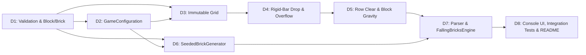

# Trackable TDD Delivery Plan (`tasks.md`): Falling Bricks Console Game (`falling-bricks-game`)

- **Goal**: Build a clean-architecture Java 21 console Falling Bricks game with seeded PRNG level generation, configurable bounds/parameters, rigid-bar airborne drop physics, horizontal row/match clearing with individual-block gravity cascades, SLF4J/Logback telemetry, and state-based unit + real multi-component integration tests.
- **Spec**: `openspec/changes/falling-bricks-game/proposal.md` & `openspec/changes/falling-bricks-game/specs/falling-bricks/spec.md`
- **Design & ADR**: `openspec/changes/falling-bricks-game/design.md` & `docs/adr/0001-falling-bricks-architecture-and-decision-matrix.md`
- **Plan Status**: **HOLDING FOR USER REVIEW** (0 / 8 Deliveries Executed — Awaiting Approval)

---

## 1. Master Trackable Delivery Matrix (`D1` – `D8`)

Each delivery is a self-contained, independently verifiable, committable vertical increment. As each delivery completes, its task checkboxes (`[x]`), `code-review-expert` verdict, `Status` (`DELIVERED`), and Git `Commit SHA` MUST be seeded back into this table on disk.

| Delivery ID | Deliverable Name | Spec Reqs & ADR Decisions | Production Artifacts | Test Artifacts (State-Based) | Verification & Review Gate | Target Commit Message | Status | Commit SHA |
| :--- | :--- | :--- | :--- | :--- | :--- | :--- | :--- | :--- |
| **D1** | **Logging Setup, Validation Types & Immutable ASCII `Block` / `Brick`** | Req 2 (`2.1–2.4`), `DEC-02`, `DEC-03`, `DEC-10`, `DEC-13` | `logback.xml`, `ValidationErrorCode`, `ValidationResult`, `Block`, `Orientation`, `Position`, `Brick` | `BlockTest`, `BrickTest` | `./gradlew check` + `code-review-expert` | `feat(domain): deliver D1 validation types and immutable ASCII Block/Brick [changes/falling-bricks-game:D1]` | `PENDING` | `—` |
| **D2** | **Configurable Parameters (`GameConfiguration`) & Overflow-Capable Queue Bounds** | Req 1 (`1.1–1.4`), Req 3 (`3.2`), `DEC-04`, `DEC-05`, `DEC-09`, `DEC-11` | `application.properties`, `GameConfiguration` | `GameConfigurationTest` | `./gradlew check` + `code-review-expert` | `feat(config): deliver D2 GameConfiguration properties and CLI validation [changes/falling-bricks-game:D2]` | `PENDING` | `—` |
| **D3** | **Immutable `Grid` Value Object & Defensive State Snapshots** | Req 1 (`1.1–1.5`), `DEC-01`, `DEC-09` | `Grid` (creation, bounds, defensive copy, `canOccupy`) | `GridTest` (Bounds & Immutability) | `./gradlew check` + `code-review-expert` | `feat(domain): deliver D3 immutable Grid with defensive snapshots [changes/falling-bricks-game:D3]` | `PENDING` | `—` |
| **D4** | **Rigid-Bar Airborne Drop Physics & Vertical Overflow Detection** | Req 4 (`4.2`), Req 6 (`6.1`), `DEC-07`, `DEC-09` | `Grid` (`computeRigidDropRow`, `lockRigidBrick`) | `GridTest` (Rigid-bar drop & `VERTICAL_OVERFLOW`) | `./gradlew check` + `code-review-expert` | `feat(domain): deliver D4 rigid-bar drop physics and vertical overflow check [changes/falling-bricks-game:D4]` | `PENDING` | `—` |
| **D5** | **Horizontal Row Clearing / Matching & Individual-Block Gravity Cascade** | Req 5 (`5.1–5.2`), `DEC-08` | `PlacementOutcome`, `Grid` (`clearMatchesAndApplyGravity`) | `GridTest` (Full row clear, symbol match, individual gravity cascade) | `./gradlew check` + `code-review-expert` | `feat(domain): deliver D5 horizontal row clearing and individual block gravity [changes/falling-bricks-game:D5]` | `PENDING` | `—` |
| **D6** | **Deterministic `SeededBrickGenerator` (`Random(seed)`) & Same-Seed Reset** | Req 3 (`3.1–3.3`), `DEC-05`, `DEC-06`, `DEC-12` | `SpawnedBrick`, `BrickGenerator`, `SeededBrickGenerator` | `SeededBrickGeneratorTest` | `./gradlew check` + `code-review-expert` | `feat(service): deliver D6 deterministic SeededBrickGenerator and retry reset [changes/falling-bricks-game:D6]` | `PENDING` | `—` |
| **D7** | **`TextCommandParser` & `FallingBricksEngine` (`TICK`, `DROP`, `RETRY`, Logging)** | Req 3 (`3.3`), Req 4 (`4.1–4.3`), Req 6 (`6.1–6.2`), `DEC-06`, `DEC-10` | `Command`, `GameStatus`, `GameSnapshot`, `CommandParser`, `TextCommandParser`, `FallingBricksEngine` | `TextCommandParserTest`, `FallingBricksEngineTest` | `./gradlew check` + `code-review-expert` | `feat(service): deliver D7 TextCommandParser and FallingBricksEngine state machine [changes/falling-bricks-game:D7]` | `PENDING` | `—` |
| **D8** | **Console UI, Real Multi-Component Integration Suite & Maintainer `README.md`** | All Reqs (`1–6`), All `DEC-01..13` | `GameRenderer`, `AsciiGameRenderer`, `ConsoleGameRunner`, `FallingBricksApplication`, `README.md` | `AsciiGameRendererTest`, `FallingBricksIntegrationTest` (Zero Mocks) | `./gradlew check` + Final 2-Axis Review + Clean Repo Audit | `feat(ui): deliver D8 console runner, real integration tests and README [changes/falling-bricks-game:D8]` | `PENDING` | `—` |

---

## 2. Global Constraints & Review Focus

### Global Constraints
- **Toolchain & Build**: Java 21 LTS (`Eclipse Temurin 21`), Gradle 9.0.0 Groovy DSL (`build.gradle`, `settings.gradle`, `gradle/libs.versions.toml` — zero Kotlin anywhere).
- **Testing Discipline**: JUnit 5 (`org.junit.jupiter`) + AssertJ (`org.assertj.core.api.Assertions.assertThat`) at **Pre-Agreed Test Seams** only; assert on actual domain/service state (`ValidationResult`, `Grid`, `GameSnapshot`), never console output strings; include real multi-component integration tests without mocks.
- **Domain Purity & Defensive State**: Zero mutable public fields on value types (`record`s), defensive collection/array copying (`List.copyOf`, 2D array cloning), zero hardcoded file paths (`InputStream`/`Reader`/`Writer` injection), and zero unused/dead code.
- **Observability**: `SLF4J + Logback` writing diagnostics to `logs/falling-bricks.log` and `WARN+` to `STDERR` so `STDOUT` console rendering is never corrupted.

### Review Focus (Mandatory Edge-Case Coverage Pinned to Deliveries)
1. **Invalid / Non-ASCII Symbols & Mutated Caller Collections** (`whitespace`, control chars, Unicode `'★'`, mutating `ArrayList<Block>` after `Brick.create`) $\rightarrow$ Pinned in **Delivery D1**.
2. **Negative/Zero/Undersized/Oversized Grids & Insufficient Brick Counts** (`width <= 0`, `width < 3`, `width > maxWidth [20]`, `brickCount * 3 <= height`) $\rightarrow$ Pinned in **Delivery D2 & D3**.
3. **Rigid-Bar Horizontal Bridging & Vertical Top-Out Overflow** (horizontal $1 \times 3$ brick stopping as a rigid bar when 1 block contacts a tall column; spawning/locking into an occupied top cell $\rightarrow$ `VERTICAL_OVERFLOW`) $\rightarrow$ Pinned in **Delivery D4**.
4. **Post-Clear Loss of Original Brick Shape (Individual-Block Column Gravity)** (clearing a row beneath a horizontal bridge causes unsupported stacked blocks above to drop independently to the floor in their own columns) $\rightarrow$ Pinned in **Delivery D5**.
5. **Empty/Dodgy Commands & Deterministic Same-Seed Level Retry** (`""`, `"   "`, `"JUMP 99"`, out-of-bounds lateral moves, and `Command.RETRY` replaying the exact same level via `Random(seed)`) $\rightarrow$ Pinned in **Delivery D6, D7 & D8**.

---

## 3. Dependency Flow Across Deliveries

---

## 4. Detailed Trackable Deliveries (`D1` – `D8`)

### Delivery D1: Logging Setup (`SLF4J + Logback`), `ValidationResult` & Printable 7-Bit ASCII `Block` / `Brick` (`P0`)
- **Status**: `PENDING`
- **Blocked by**: None (Frontier Ready)
- **Demoable Behavior**: Validating printable 7-bit ASCII `Block`s (`0x21..0x7E`), constructing immutable 3-block `Brick`s with defensive `List.copyOf`, toggling orientation, cycling block order, and computing span geometry (`widthSpan()`, `heightSpan()`, `occupiedPositions(col, row)`).
- **Pre-Agreed Seam**: `com.fallingbricks.domain.Block#create`, `com.fallingbricks.domain.Brick#create`
- **Files**:
  - Create/Modify: `gradle/libs.versions.toml`, `build.gradle`, `src/main/resources/logback.xml`, `src/main/java/com/fallingbricks/domain/{ValidationErrorCode,ValidationResult,Block,Orientation,Position,Brick}.java`
  - Test: `src/test/java/com/fallingbricks/domain/{BlockTest,BrickTest}.java`
- **Interfaces**:
  - *Consumes*: JDK 21 standard library (`java.util.List`, `java.util.Optional`).
  - *Produces*: `ValidationResult<T>` (`Valid<T>`, `Invalid<T>`), `ValidationErrorCode`, `Block.create(char)`, `Brick.create(List<Block>, Orientation)`, `brick.toggleOrientation()`, `brick.cycleBlocks()`, `brick.widthSpan()`, `brick.heightSpan()`, `brick.occupiedPositions(int, int)`.
- **Steps**:
  - [ ] **D1.1 (RED)**: Configure `slf4j-api` & `logback-classic` in `gradle/libs.versions.toml` and `build.gradle` with `src/main/resources/logback.xml`; write failing JUnit 5 + AssertJ tests in `BlockTest` and `BrickTest` covering `Scenarios 2.1–2.4` and Review Focus #1.
  - [ ] **D1.2 (Verify RED)**: Run `./gradlew test --info` and confirm tests fail for the expected behavioral reason.
  - [ ] **D1.3 (GREEN)**: Implement `ValidationErrorCode`, `ValidationResult`, `Block`, `Orientation`, `Position`, and `Brick`.
  - [ ] **D1.4 (Verify GREEN + Mutation Check)**: Run `./gradlew check --build-cache --parallel` (0 failures, 0 warnings) and verify boundary mutations fail tests.
  - [ ] **D1.5 (Two-Axis Code Review & Refactor Loop)**: Run `code-review-expert` audit on D1 $\rightarrow$ apply any refactorings via `java-expert` $\rightarrow$ re-run `./gradlew check`.
  - [ ] **D1.6 (Commit & Record SHA)**: Commit with `[changes/falling-bricks-game:D1]` and seed `DELIVERED` + Commit SHA into the Master Trackable Delivery Matrix above.

---

### Delivery D2: `GameConfiguration` (`application.properties` + CLI Overrides + Overflow-Capable Queue Bounds) (`P0`)
- **Status**: `PENDING`
- **Blocked by**: `D1`
- **Demoable Behavior**: Loading and validating all game parameters (`width`, `height`, `maxWidth`, `maxHeight`, `brickCount`, `seed`, `tickIntervalMs`, `symbols`, `maxBrickSpan`) from defaults, `InputStream` (`Properties`), and CLI flags with zero hardcoded paths, rejecting negative/undersized/oversized grids and insufficient `brickCount` (`brickCount * 3 <= height`).
- **Pre-Agreed Seam**: `com.fallingbricks.config.GameConfiguration#load`, `GameConfiguration#create`
- **Files**:
  - Create/Modify: `src/main/resources/application.properties`, `src/main/java/com/fallingbricks/config/GameConfiguration.java`
  - Test: `src/test/java/com/fallingbricks/config/GameConfigurationTest.java`
- **Interfaces**:
  - *Consumes*: `ValidationResult<T>`, `ValidationErrorCode`, `Block.isValidAsciiSymbol(char)`.
  - *Produces*: `GameConfiguration.defaults()`, `GameConfiguration.fromPropertiesAndArgs(InputStream, String[])`, `GameConfiguration.create(...)`.
- **Steps**:
  - [ ] **D2.1 (RED)**: Write failing JUnit 5 + AssertJ tests in `GameConfigurationTest` covering `Scenarios 1.1–1.4`, `Scenario 3.2`, and Review Focus #2.
  - [ ] **D2.2 (Verify RED)**: Run `./gradlew test --tests com.fallingbricks.config.GameConfigurationTest --info` and confirm expected failure.
  - [ ] **D2.3 (GREEN)**: Implement `GameConfiguration` and `src/main/resources/application.properties`.
  - [ ] **D2.4 (Verify GREEN + Mutation Check)**: Run `./gradlew check --build-cache --parallel` (0 failures, 0 warnings).
  - [ ] **D2.5 (Two-Axis Code Review & Refactor Loop)**: Run `code-review-expert` audit on D2 $\rightarrow$ apply any refactorings $\rightarrow$ re-run `./gradlew check`.
  - [ ] **D2.6 (Commit & Record SHA)**: Commit with `[changes/falling-bricks-game:D2]` and seed `DELIVERED` + Commit SHA into the Master Trackable Delivery Matrix above.

---

### Delivery D3: Immutable `Grid` Value Object & Defensive State Snapshots (`P0`)
- **Status**: `PENDING`
- **Blocked by**: `D1`, `D2`
- **Demoable Behavior**: Creating an immutable 2D `Grid` within configurable `[3..maxWidth] x [3..maxHeight]` bounds, querying cells and defensive 2D snapshots (`cellsSnapshot()`), and checking `canOccupy(brick, anchorCol, anchorRow)`.
- **Pre-Agreed Seam**: `com.fallingbricks.domain.Grid#create`, `Grid#cellsSnapshot`, `Grid#canOccupy`
- **Files**:
  - Create/Modify: `src/main/java/com/fallingbricks/domain/Grid.java`
  - Test: `src/test/java/com/fallingbricks/domain/GridTest.java`
- **Interfaces**:
  - *Consumes*: `Block`, `Brick`, `Position`, `ValidationResult<T>`, `ValidationErrorCode`.
  - *Produces*: `Grid.create(int, int)`, `Grid.create(int, int, int, int)`, `grid.cellAt(int, int)`, `grid.cellsSnapshot()`, `grid.canOccupy(Brick, int, int)`.
- **Steps**:
  - [ ] **D3.1 (RED)**: Write failing JUnit 5 + AssertJ tests in `GridTest` covering `Scenarios 1.1–1.5` (bounds, defensive 2D array copy, `canOccupy`).
  - [ ] **D3.2 (Verify RED)**: Run `./gradlew test --tests com.fallingbricks.domain.GridTest --info` and confirm expected failure.
  - [ ] **D3.3 (GREEN)**: Implement `Grid` creation, defensive snapshot copying, and `canOccupy`.
  - [ ] **D3.4 (Verify GREEN + Mutation Check)**: Run `./gradlew check --build-cache --parallel` (0 failures, 0 warnings).
  - [ ] **D3.5 (Two-Axis Code Review & Refactor Loop)**: Run `code-review-expert` audit on D3 $\rightarrow$ apply any refactorings $\rightarrow$ re-run `./gradlew check`.
  - [ ] **D3.6 (Commit & Record SHA)**: Commit with `[changes/falling-bricks-game:D3]` and seed `DELIVERED` + Commit SHA into the Master Trackable Delivery Matrix above.

---

### Delivery D4: Rigid-Bar Airborne Drop Physics (`Q3`) & Vertical Overflow Detection (`Q5`) (`P0`)
- **Status**: `PENDING`
- **Blocked by**: `D3`
- **Demoable Behavior**: Dropping both `VERTICAL` ($3 \times 1$) and `HORIZONTAL` ($1 \times 3$) bricks as **rigid 3-block bars** (stopping at the highest row where any of the 3 blocks contacts the floor or a stacked block below), and returning `ValidationErrorCode.VERTICAL_OVERFLOW` when a brick overlaps an occupied cell or overflows `height - 1`.
- **Pre-Agreed Seam**: `com.fallingbricks.domain.Grid#computeRigidDropRow`, `Grid#lockRigidBrick`
- **Files**:
  - Create/Modify: `src/main/java/com/fallingbricks/domain/Grid.java`
  - Test: `src/test/java/com/fallingbricks/domain/GridTest.java`
- **Interfaces**:
  - *Consumes*: `Grid.canOccupy(Brick, int, int)`, `Brick.occupiedPositions(int, int)`.
  - *Produces*: `grid.computeRigidDropRow(Brick, int, int)`, `grid.lockRigidBrick(Brick, int, int)`.
- **Steps**:
  - [ ] **D4.1 (RED)**: Write failing JUnit 5 + AssertJ tests in `GridTest` covering `Scenario 4.2`, `Scenario 6.1`, and Review Focus #3 (rigid horizontal bar bridging over uneven columns + `VERTICAL_OVERFLOW`).
  - [ ] **D4.2 (Verify RED)**: Run `./gradlew test --tests com.fallingbricks.domain.GridTest --info` and confirm expected failure.
  - [ ] **D4.3 (GREEN)**: Implement `computeRigidDropRow` and `lockRigidBrick` on `Grid`.
  - [ ] **D4.4 (Verify GREEN + Mutation Check)**: Run `./gradlew check --build-cache --parallel` (0 failures, 0 warnings).
  - [ ] **D4.5 (Two-Axis Code Review & Refactor Loop)**: Run `code-review-expert` audit on D4 $\rightarrow$ apply any refactorings $\rightarrow$ re-run `./gradlew check`.
  - [ ] **D4.6 (Commit & Record SHA)**: Commit with `[changes/falling-bricks-game:D4]` and seed `DELIVERED` + Commit SHA into the Master Trackable Delivery Matrix above.

---

### Delivery D5: Horizontal Row Clearing / Matching & Individual-Block Gravity Cascade (`Q4`) (`P0`)
- **Status**: `PENDING`
- **Blocked by**: `D4`
- **Demoable Behavior**: Detecting and clearing full horizontal rows (`width` occupied cells) and horizontal contiguous symbol matches (`>= 3` identical symbols in a row), then dropping all stacked blocks above via **independent per-column block gravity** (original 3-block rigid shape no longer applies once stacked) in a chain-cascade loop.
- **Pre-Agreed Seam**: `com.fallingbricks.domain.Grid#lockAndResolve`, `Grid#resolveClearsAndGravity`, `PlacementOutcome`
- **Files**:
  - Create/Modify: `src/main/java/com/fallingbricks/domain/{PlacementOutcome,Grid}.java`
  - Test: `src/test/java/com/fallingbricks/domain/GridTest.java`
- **Interfaces**:
  - *Consumes*: `Grid`, `Block`, `Brick`.
  - *Produces*: `PlacementOutcome(Grid grid, int rowsOrMatchesCleared, int blocksCleared, int chainCount, int pointsEarned)`, `grid.resolveClearsAndGravity()`, `grid.dropAndResolve(Brick, int, int)`.
- **Steps**:
  - [ ] **D5.1 (RED)**: Write failing JUnit 5 + AssertJ tests in `GridTest` covering `Scenarios 5.1–5.2` and Review Focus #4 (full row clear + overhanging horizontal bridge splitting into individual falling blocks under column gravity + multi-step chain cascade).
  - [ ] **D5.2 (Verify RED)**: Run `./gradlew test --tests com.fallingbricks.domain.GridTest --info` and confirm expected failure.
  - [ ] **D5.3 (GREEN)**: Implement `PlacementOutcome` and horizontal clear + per-column gravity cascade in `Grid`.
  - [ ] **D5.4 (Verify GREEN + Mutation Check)**: Run `./gradlew check --build-cache --parallel` (0 failures, 0 warnings).
  - [ ] **D5.5 (Two-Axis Code Review & Refactor Loop)**: Run `code-review-expert` audit on D5 $\rightarrow$ apply any refactorings $\rightarrow$ re-run `./gradlew check`.
  - [ ] **D5.6 (Commit & Record SHA)**: Commit with `[changes/falling-bricks-game:D5]` and seed `DELIVERED` + Commit SHA into the Master Trackable Delivery Matrix above.

---

### Delivery D6: Deterministic `SeededBrickGenerator` (`Random(seed)`) & Same-Seed Reset (`Q1` & `Q2`) (`P0`)
- **Status**: `PENDING`
- **Blocked by**: `D1`, `D2`
- **Demoable Behavior**: Generating a finite, overflow-capable stream of `SpawnedBrick(Brick, spawnCol)` items deterministically from `java.util.Random(seed)` where `0 <= spawnCol <= gridWidth - brick.widthSpan()`, and rewinding to the exact same level sequence via `resetWithSameSeed()`.
- **Pre-Agreed Seam**: `com.fallingbricks.port.BrickGenerator`, `com.fallingbricks.service.SeededBrickGenerator`
- **Files**:
  - Create/Modify: `src/main/java/com/fallingbricks/port/{SpawnedBrick,BrickGenerator}.java`, `src/main/java/com/fallingbricks/service/SeededBrickGenerator.java`
  - Test: `src/test/java/com/fallingbricks/service/SeededBrickGeneratorTest.java`
- **Interfaces**:
  - *Consumes*: `GameConfiguration`, `Block`, `Brick`, `Orientation`.
  - *Produces*: `SpawnedBrick(Brick brick, int spawnCol)`, `BrickGenerator` (`nextSpawnedBrick()`, `peekNext()`, `remainingCount()`, `seed()`, `resetWithSameSeed()`, `resetWithNewSeed(long)`), `SeededBrickGenerator`.
- **Steps**:
  - [ ] **D6.1 (RED)**: Write failing JUnit 5 + AssertJ tests in `SeededBrickGeneratorTest` covering `Scenarios 3.1–3.3` (predictive seed determinism, valid top `spawnCol`, finite exhaustion, and `resetWithSameSeed()`).
  - [ ] **D6.2 (Verify RED)**: Run `./gradlew test --tests com.fallingbricks.service.SeededBrickGeneratorTest --info` and confirm expected failure.
  - [ ] **D6.3 (GREEN)**: Implement `SpawnedBrick`, `BrickGenerator`, and `SeededBrickGenerator`.
  - [ ] **D6.4 (Verify GREEN + Mutation Check)**: Run `./gradlew check --build-cache --parallel` (0 failures, 0 warnings).
  - [ ] **D6.5 (Two-Axis Code Review & Refactor Loop)**: Run `code-review-expert` audit on D6 $\rightarrow$ apply any refactorings $\rightarrow$ re-run `./gradlew check`.
  - [ ] **D6.6 (Commit & Record SHA)**: Commit with `[changes/falling-bricks-game:D6]` and seed `DELIVERED` + Commit SHA into the Master Trackable Delivery Matrix above.

---

### Delivery D7: `TextCommandParser` & `FallingBricksEngine` (`TICK`, `DROP`, `RETRY`, `VERTICAL_OVERFLOW` & SLF4J Logging) (`P0`)
- **Status**: `PENDING`
- **Blocked by**: `D5`, `D6`
- **Demoable Behavior**: Parsing raw player input into `ValidationResult<Command>`, spawning bricks at random top columns, moving/rotating/cycling airborne bricks, stepping down 1 row on timer `Command.TICK` or dropping immediately on `Command.DROP`, transitioning to `COMPLETED` or `GAME_OVER` (`VERTICAL_OVERFLOW`), replaying the exact same level on `Command.RETRY`, and logging via SLF4J.
- **Pre-Agreed Seam**: `com.fallingbricks.port.CommandParser#parse`, `com.fallingbricks.service.FallingBricksEngine#execute`, `FallingBricksEngine#snapshot`
- **Files**:
  - Create/Modify: `src/main/java/com/fallingbricks/domain/{Command,GameStatus,GameSnapshot}.java`, `src/main/java/com/fallingbricks/port/CommandParser.java`, `src/main/java/com/fallingbricks/ui/TextCommandParser.java`, `src/main/java/com/fallingbricks/service/FallingBricksEngine.java`
  - Test: `src/test/java/com/fallingbricks/ui/TextCommandParserTest.java`, `src/test/java/com/fallingbricks/service/FallingBricksEngineTest.java`
- **Interfaces**:
  - *Consumes*: `Grid`, `Brick`, `PlacementOutcome`, `BrickGenerator`, `GameConfiguration`, `ValidationResult<T>`.
  - *Produces*: `CommandParser.parse(String)`, `FallingBricksEngine.execute(Command)`, `FallingBricksEngine.snapshot() -> GameSnapshot`.
- **Steps**:
  - [ ] **D7.1 (RED)**: Write failing JUnit 5 + AssertJ tests in `TextCommandParserTest` and `FallingBricksEngineTest` covering `Scenario 3.3`, `Scenarios 4.1–4.3`, `Scenarios 6.1–6.2`, and Review Focus #5.
  - [ ] **D7.2 (Verify RED)**: Run `./gradlew test --info` and confirm expected failure.
  - [ ] **D7.3 (GREEN)**: Implement `Command`, `GameStatus`, `GameSnapshot`, `CommandParser`, `TextCommandParser`, and `FallingBricksEngine` with SLF4J logging.
  - [ ] **D7.4 (Verify GREEN + Mutation Check)**: Run `./gradlew check --build-cache --parallel` (0 failures, 0 warnings).
  - [ ] **D7.5 (Two-Axis Code Review & Refactor Loop)**: Run `code-review-expert` audit on D7 $\rightarrow$ apply any refactorings $\rightarrow$ re-run `./gradlew check`.
  - [ ] **D7.6 (Commit & Record SHA)**: Commit with `[changes/falling-bricks-game:D7]` and seed `DELIVERED` + Commit SHA into the Master Trackable Delivery Matrix above.

---

### Delivery D8: Console UI (`AsciiGameRenderer`, `ConsoleGameRunner`), Real Multi-Component Integration Suite & `README.md` (`P0`)
- **Status**: `PENDING`
- **Blocked by**: `D7`
- **Demoable Behavior**: Running the complete console game end-to-end with `AsciiGameRenderer` matching the approved UI mockups (`proposal.md` §2), verified by `FallingBricksIntegrationTest` running all real components together without mocks (full level completion, validation rejections, `VERTICAL_OVERFLOW`, and same-seed `RETRY`), plus a maintainer-ready `README.md`.
- **Pre-Agreed Seam**: `com.fallingbricks.ui.ConsoleGameRunner#run`, `com.fallingbricks.port.GameRenderer`
- **Files**:
  - Create/Modify: `src/main/java/com/fallingbricks/port/GameRenderer.java`, `src/main/java/com/fallingbricks/ui/{AsciiGameRenderer,ConsoleGameRunner}.java`, `src/main/java/com/fallingbricks/cli/FallingBricksApplication.java`, `README.md` (and remove starter `org/example/App.java` & `AppTest.java`)
  - Test: `src/test/java/com/fallingbricks/ui/AsciiGameRendererTest.java`, `src/test/java/com/fallingbricks/integration/FallingBricksIntegrationTest.java`
- **Interfaces**:
  - *Consumes*: `GameConfiguration`, `SeededBrickGenerator`, `TextCommandParser`, `FallingBricksEngine`, `GameSnapshot`.
  - *Produces*: `GameRenderer`, `AsciiGameRenderer`, `ConsoleGameRunner.run()`, `FallingBricksApplication.main(String[])`, `README.md`.
- **Steps**:
  - [ ] **D8.1 (RED)**: Write failing JUnit 5 + AssertJ tests in `AsciiGameRendererTest` and `FallingBricksIntegrationTest` (wiring real `GameConfiguration` + real `SeededBrickGenerator` + real `TextCommandParser` + real `FallingBricksEngine` + real `AsciiGameRenderer` + real `ConsoleGameRunner` with zero mocks).
  - [ ] **D8.2 (Verify RED)**: Run `./gradlew test --info` and confirm expected failure.
  - [ ] **D8.3 (GREEN)**: Implement `GameRenderer`, `AsciiGameRenderer`, `ConsoleGameRunner`, and `FallingBricksApplication`; remove unused starter `org.example.App` / `AppTest`.
  - [ ] **D8.4 (Verify GREEN + Mutation Check)**: Run `./gradlew check --build-cache --parallel` (0 failures, 0 warnings).
  - [ ] **D8.5 (Two-Axis Code Review, Unused Code Strip & `README.md`)**: Run full `code-review-expert` audit across the entire repository, strip any unused code/imports, and generate `README.md` via `readme-generator`.
  - [ ] **D8.6 (Commit & Record SHA)**: Commit with `[changes/falling-bricks-game:D8]`, seed `DELIVERED` + Commit SHA into the Master Trackable Delivery Matrix above, and push to `origin/main`.
